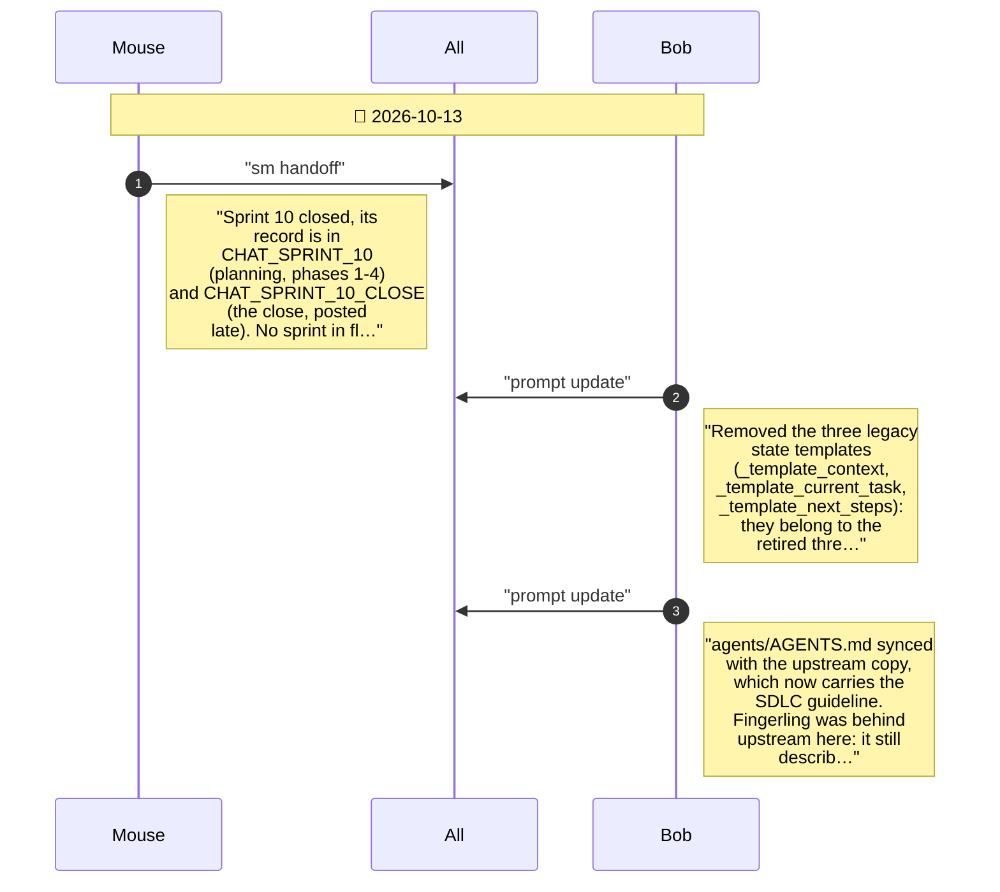

# CHAT_POST_SPRINT_10 — Sprint Archive

## Summary

Maintenance after Sprint 10 (2026-10-13): legacy state templates removed, stories template generalised, agents/AGENTS.md synced with upstream, and the BobProtocol sync completed - bob_protocol now ships the build-env skill, SDLC and rubric templates and the SDLC guideline. Shutdown hand-off.

