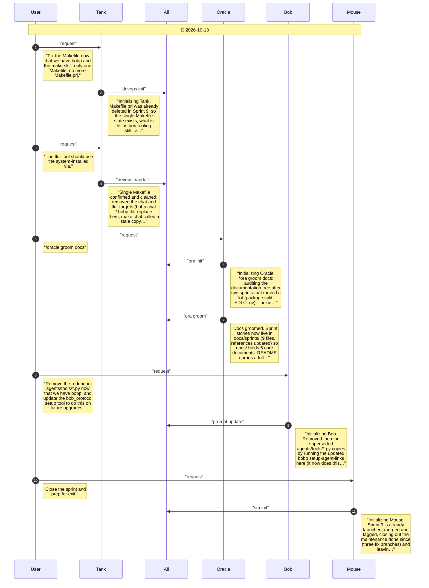

# CHAT_POST_SPRINT_9 — Sprint Archive

## Summary

Maintenance after Sprint 9 (2026-10-13), each change on its own fix/ branch and merged to main: one Makefile with no team-tooling targets; documentation tree groomed (sprint stories to docs/sprints/, README map, agents index); nine stale agents/tools copies of bobp tools removed; session close-out. In bob_protocol (uncommitted there): bobp tldr now uses the system via command and indexes first, and bobp setup-agent-links removes the legacy tool copies. No release - the published package did not change.

