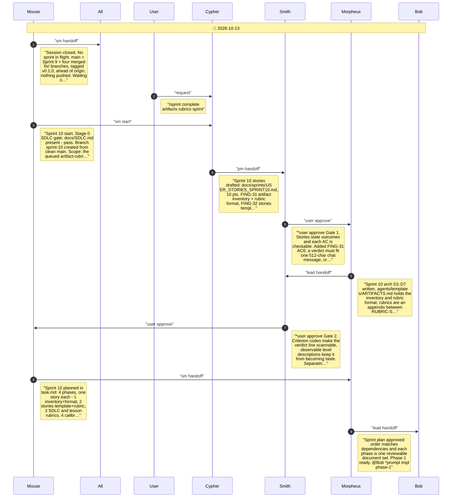
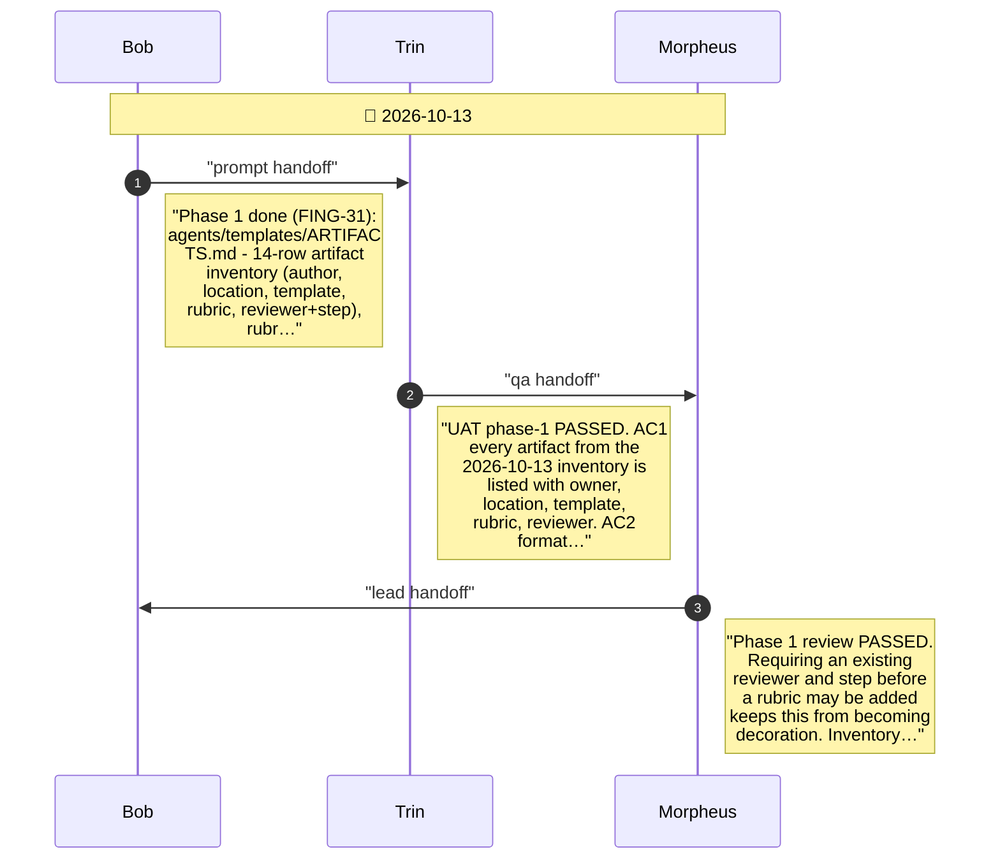
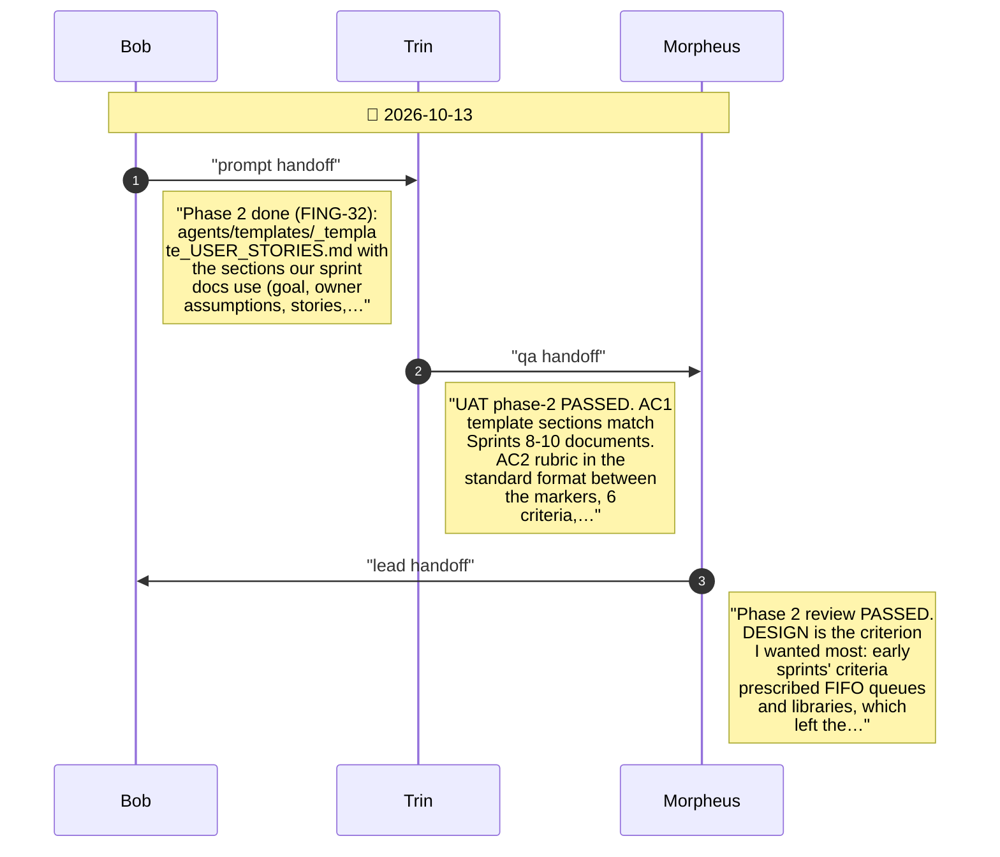
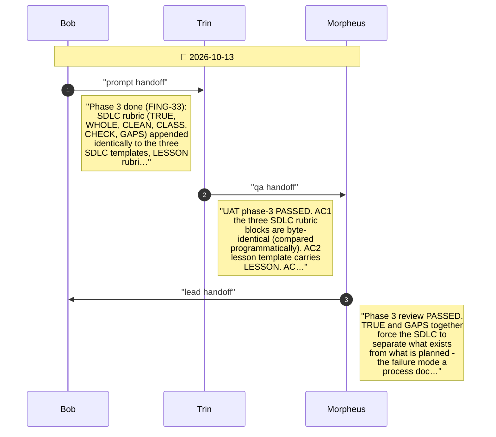
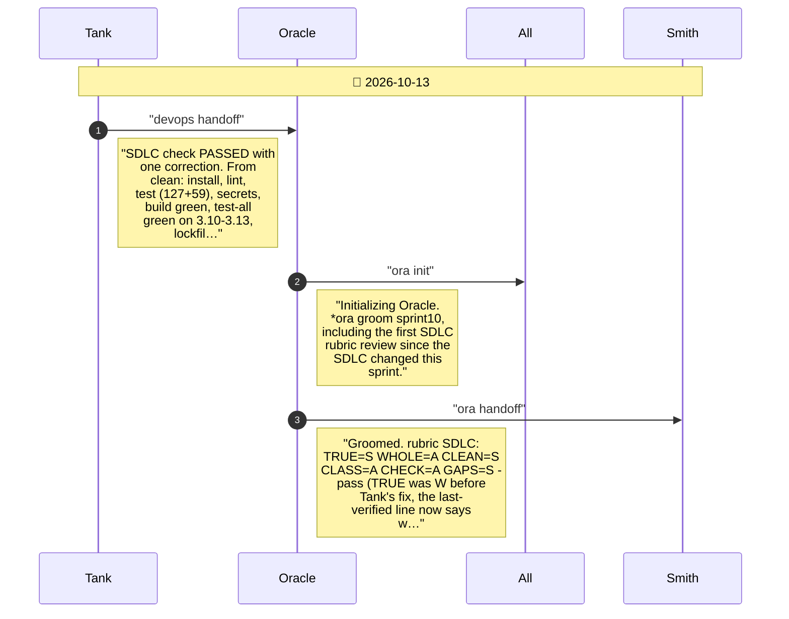

# CHAT_SPRINT_10 — Sprint Archive

## Summary

Sprint 10 - Artifact Rubrics (2026-10-13), on branch sprint-10. Delivered STORY-FING-31..34 (10/10 pts): an inventory of the artifacts agents produce and a standard rubric format (agents/templates/ARTIFACTS.md); a sprint stories template with a STORIES rubric applied at Smith's Gate 1; SDLC and LESSON rubrics applied by Oracle at groom and Smith at the close test; and a calibration on existing documents that reworded three criteria and found one stale statement in the SDLC. Process-only sprint: no release, nothing pushed.

---

## Planning

---

## Phase 1

Inventory and rubric format (STORY-FING-31): one document listing every artifact agents are expected to produce, and defining how a rubric is written, applied and reported.

---

## Phase 2

Stories template and rubric (STORY-FING-32): a template for the sprint stories document with a STORIES rubric appended, applied by Cypher as a self-check and by Smith at Gate 1.

---

## Phase 3

SDLC and lesson rubrics (STORY-FING-33): add an SDLC rubric to the three SDLC templates and a LESSON rubric to the lesson template, each with an independent reviewer at an existing step.

---

## Phase 4

Calibration (STORY-FING-34): apply the three rubrics to documents we already have, to see whether they separate strong work from weak, and reword any criterion that does not apply cleanly.

