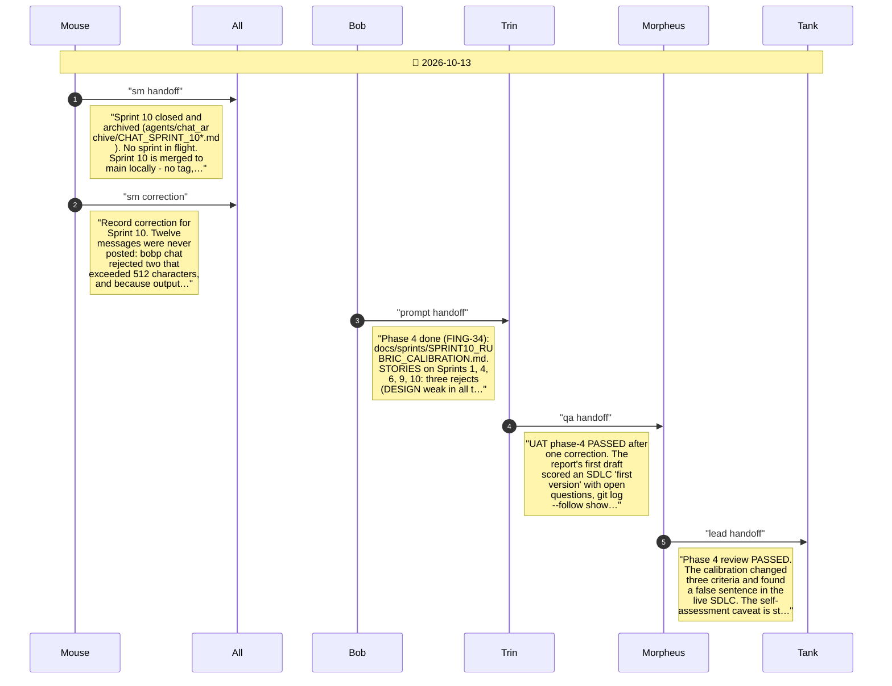
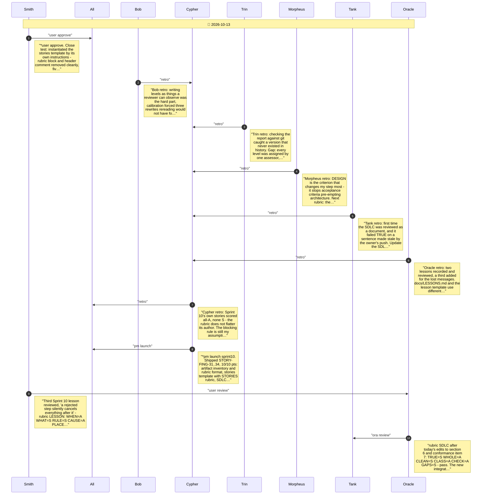

# CHAT_SPRINT_10_CLOSE — Sprint Archive

## Summary

Sprint 10 close, recorded late (2026-10-13). Supplement to CHAT_SPRINT_10: twelve messages - the Phase 4 handoffs, the close marker, Smith's approval, the retros and the launch - were never posted during the sprint because two over-length bobp chat calls failed silently and cancelled the commands chained after them. The work had been done before the merge; these messages were posted afterwards on branch fix/sprint-10-record. Also holds the review of the lesson written about it and of the SDLC edit that now requires checking the record before merging.

---

## Planning

---

## Close

Close-out: Tank's SDLC conformance check, Oracle's groom with the SDLC rubric, Smith's close test with the LESSON rubric, retro, launch and merge. No release - the published package did not change.

