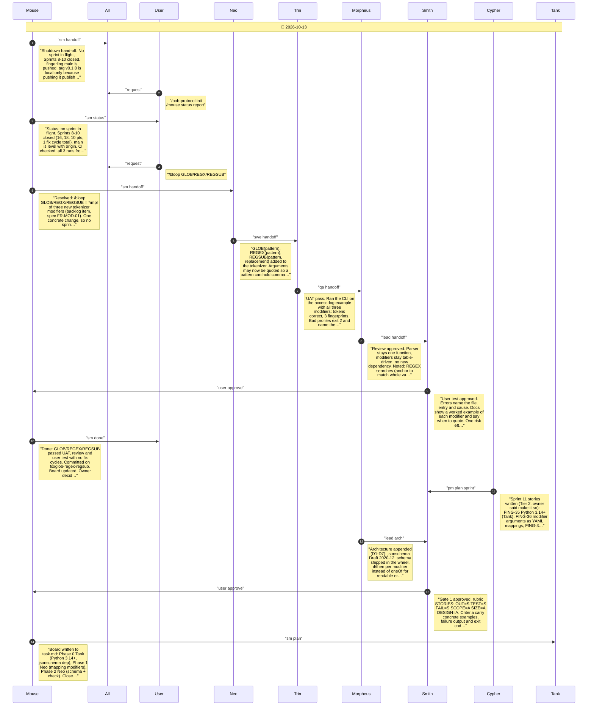
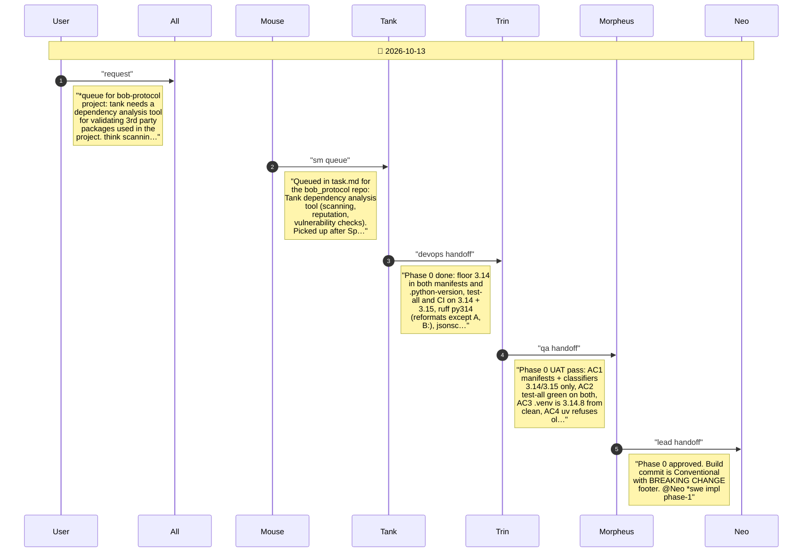
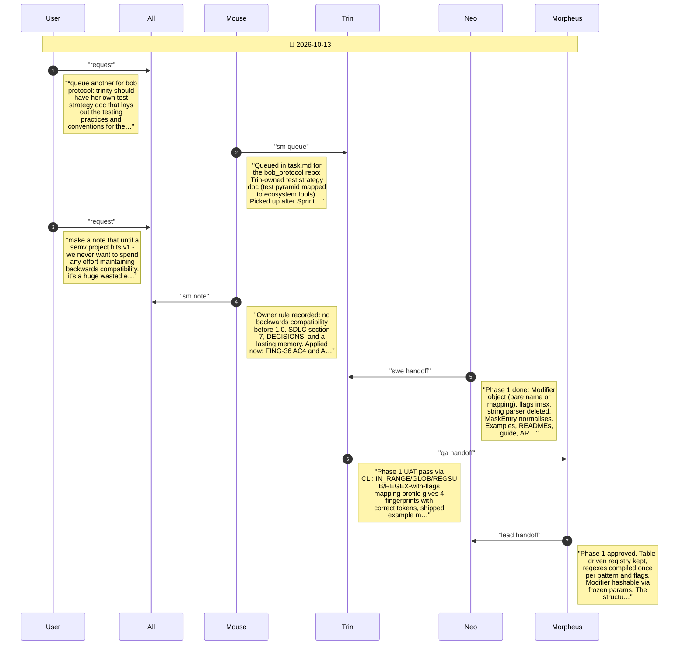
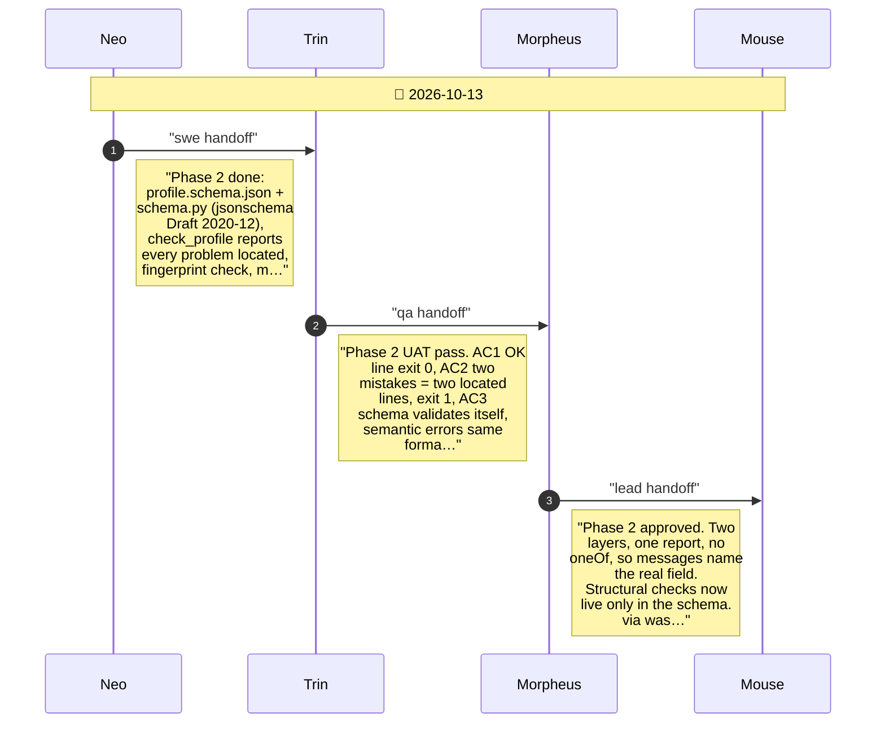
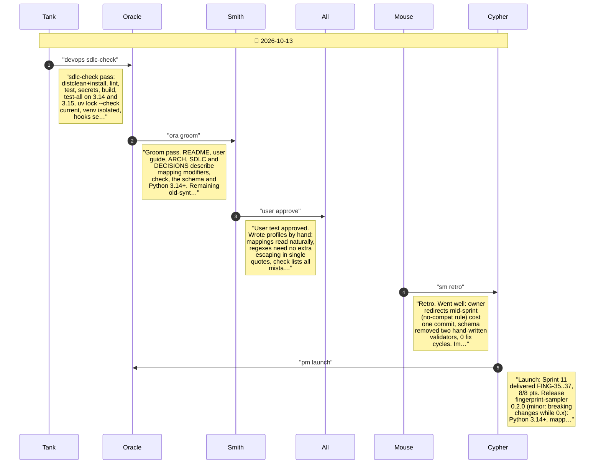

# CHAT_SPRINT_11 — Sprint Archive

## Summary

Sprint 11 - Structured Modifiers and Profile Checking (2026-10-13). Tier 2, 8/8 pts, STORY-FING-35..37, on branch sprint-11. Python 3.14+ only (tested on 3.14 and 3.15); modifier arguments written as YAML mappings, string parser removed; profiles checked against a shipped JSON Schema by jsonschema, with fingerprint check listing every problem. Owner rule recorded: no backwards compatibility before 1.0. 0 fix cycles. Released as fingerprint-sampler 0.2.0 (tag v0.2.0, local). The Planning section also holds the pre-sprint status report and the GLOB/REGEX/REGSUB change merged on fix/glob-regex-regsub.

---

## Planning

---

## Phase 0

Phase 0: move the project to Python 3.14 and later, test on 3.14 and 3.15, and add the jsonschema dependency the profile checker will use.

---

## Phase 1

Phase 1: modifier arguments are written as YAML mappings (name plus named arguments, flags for regexes); the string argument syntax and its parser are removed.

---

## Phase 2

Phase 2: profiles are checked against a published JSON Schema; fingerprint check lists every problem with its location; merge runs the same check; editors can use the schema while typing.

---

## Close

Close: Tank sdlc-check, Oracle groom, Smith user test, retro, launch, chat report, then merge and release 0.2.0.

