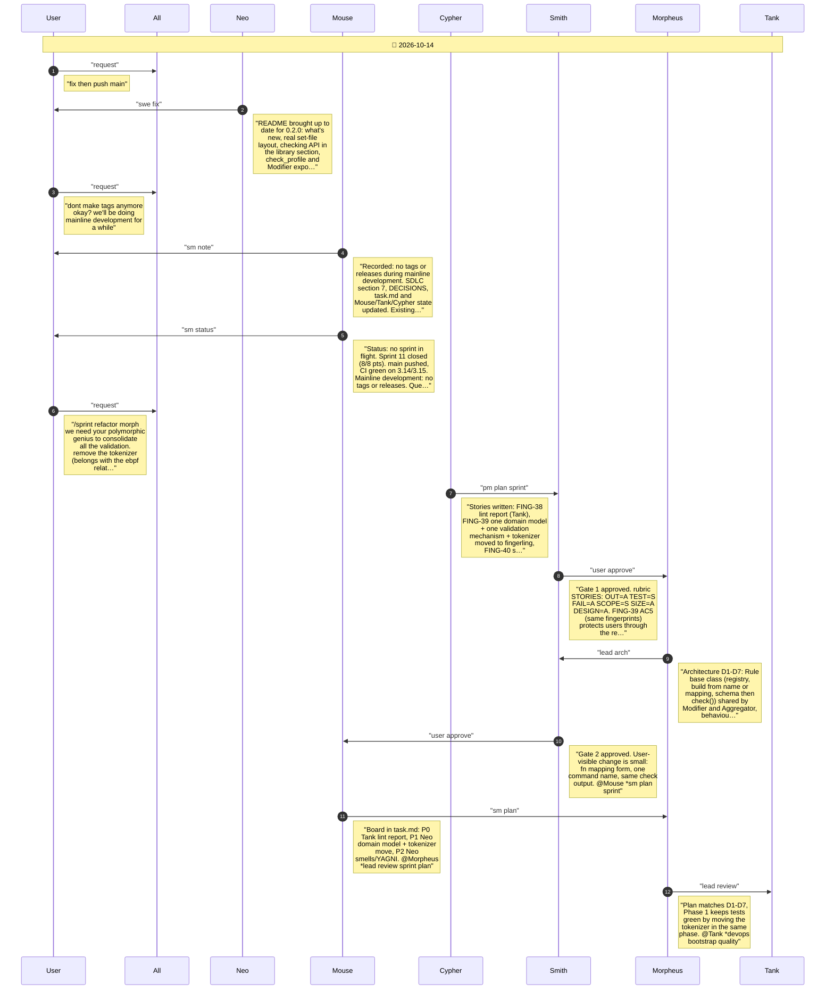
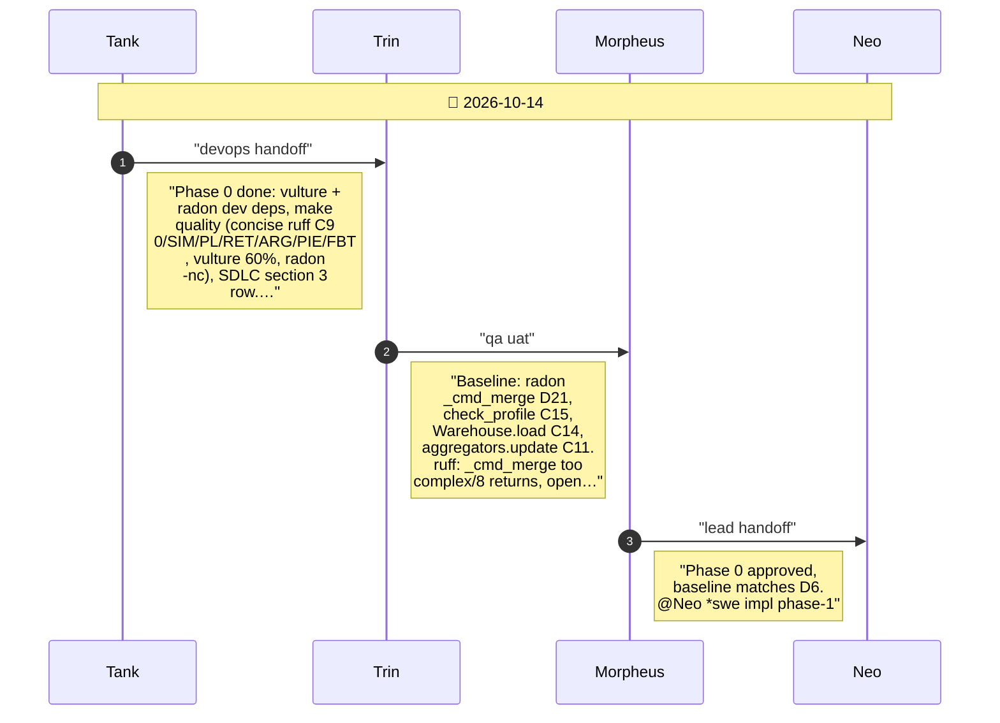
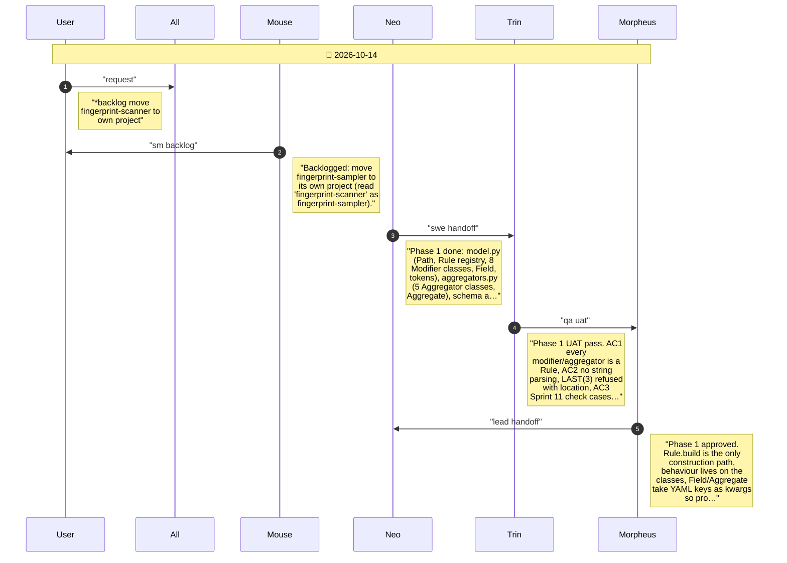
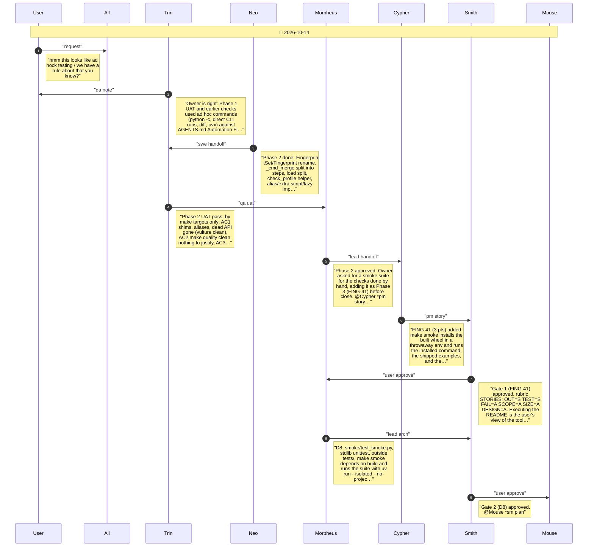
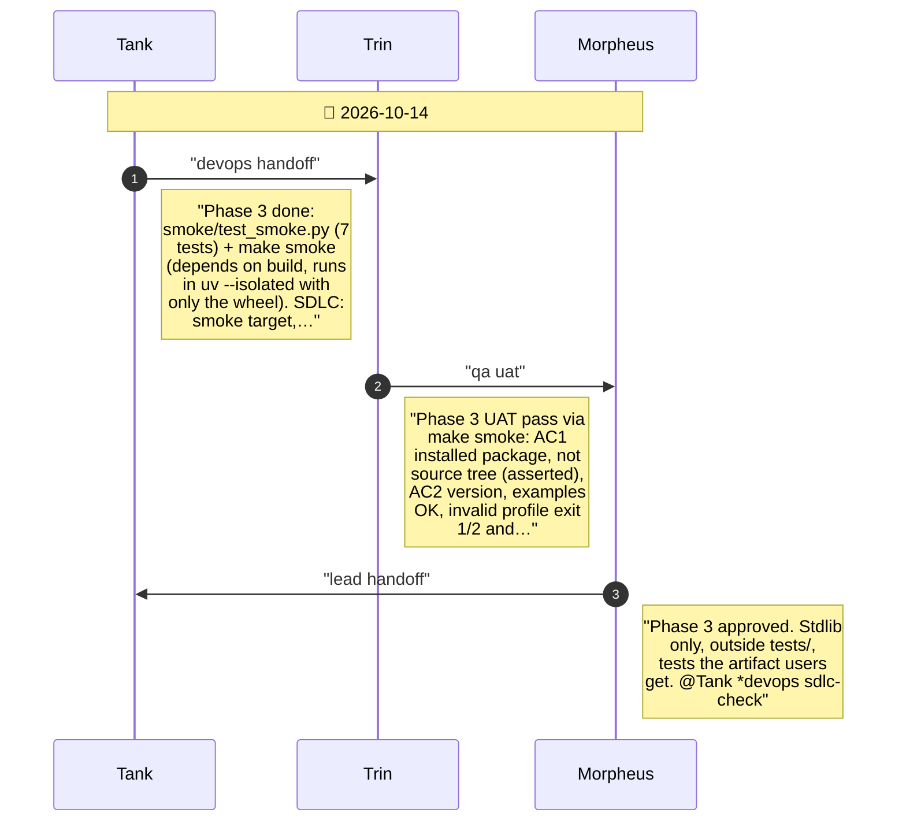
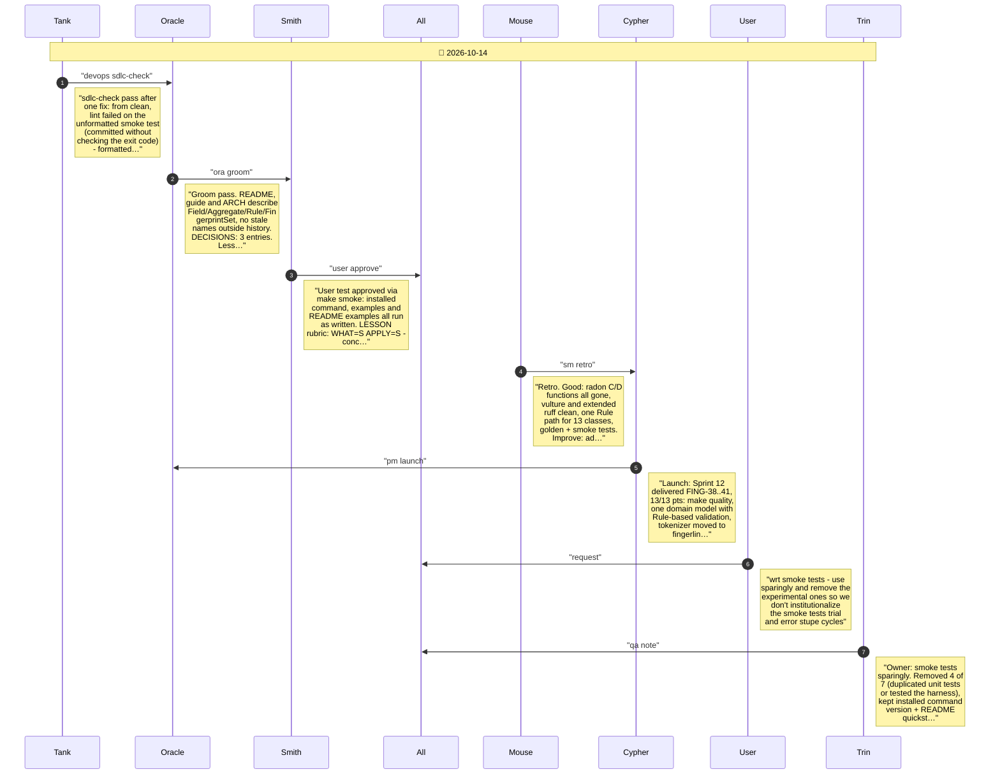

# CHAT_SPRINT_12 — Sprint Archive

## Summary

Sprint 12 - Domain Model and Consolidated Validation (2026-10-14). Tier 1, 13/13 pts, STORY-FING-38..41, branch sprint-12. make quality (extended ruff, vulture, radon) as a report; modifiers and aggregate functions became Rule classes with one build-and-check path; the tokenizer moved to fingerling; shims, aliases and dead code removed; Warehouse renamed FingerprintSet; worst functions split until make quality was clean. Mid-sprint the owner flagged ad hoc testing, so a smoke suite on the installed wheel was added (FING-41), then trimmed to 3 tests at close. No release (mainline development).

---

## Planning

---

## Phase 0

Phase 0: add a report-only make quality target (extended ruff, vulture, radon) and post the baseline smell list that drives the refactor.

---

## Phase 1

Phase 1: one domain model - modifiers and aggregate functions become Rule classes that build and check themselves the same way; the tokenizer module moves to the eBPF-side fingerling package.

---

## Phase 2

Phase 2: remove dead code and aliases, rename the set classes to the domain names, and split the worst-graded functions until make quality is clean.

---

## Phase 3

Phase 3: a smoke suite that installs the built wheel in a clean environment and runs the real command, the shipped examples and the README's own examples, behind make smoke.

---

## Close

Close: Tank sdlc-check, Oracle groom, Smith user test, retro, launch, chat report, merge. No release (mainline).

