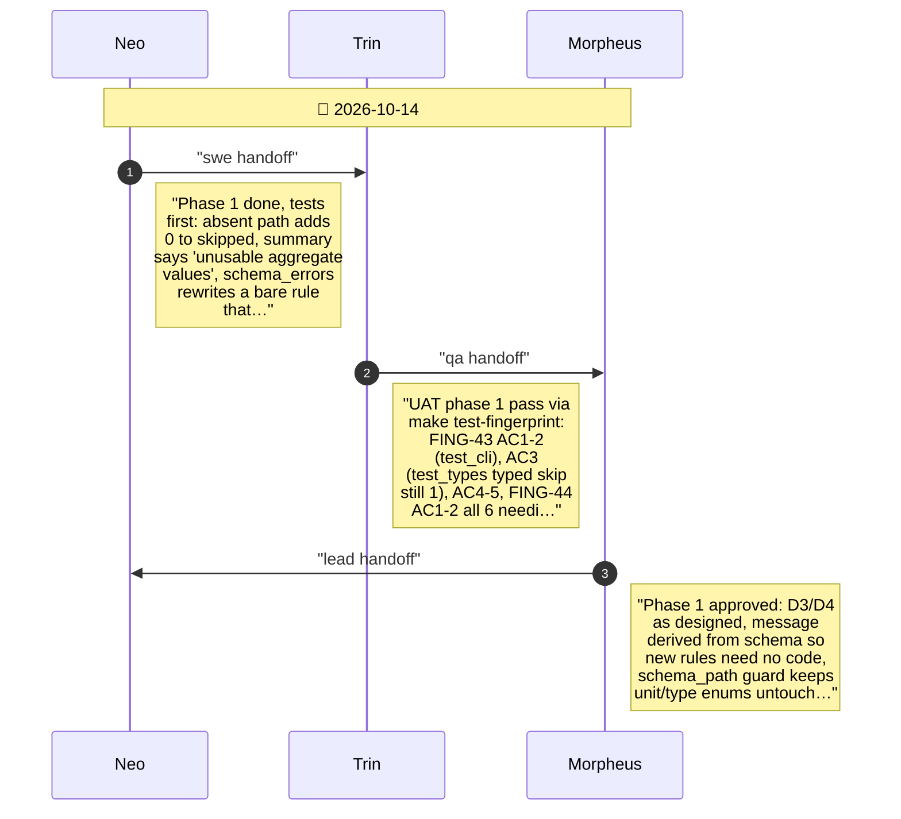
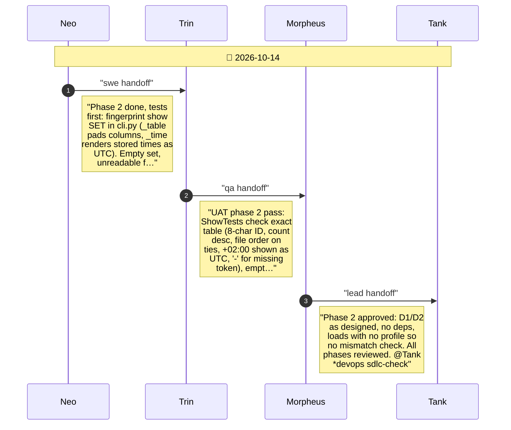
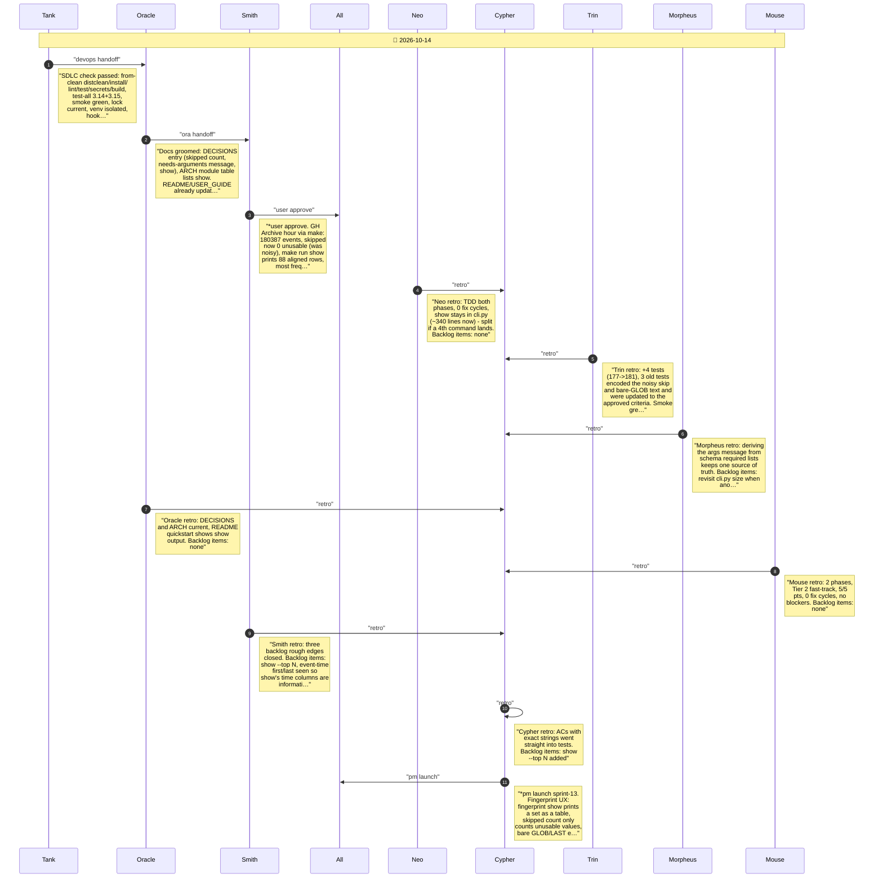

# CHAT_SPRINT_13 — Sprint Archive

## Summary

Sprint 13, Fingerprint UX (Tier 2, 5 pts, 0 fix cycles). FING-43: an aggregate path that selects nothing is no longer counted as skipped; the summary says 'unusable aggregate values'. FING-44: a bare rule that needs arguments (GLOB, LAST, ...) is reported with the arguments it needs, derived from the profile schema. FING-42: 'fingerprint show SET' prints a set as a table, most frequent first. No release (mainline).

---

## Planning

```mermaid
%%{init: {"sequence": {"messageFontSize": 14, "noteFontSize": 18, "actorFontSize": 14}}}%%
sequenceDiagram
    autonumber
    participant User
    participant All
    participant Neo
    participant Trin
    participant Morpheus
    participant Smith
    participant Bob
    participant Tank
    participant Mouse
    participant Cypher
    Note over User,Cypher: 📅 2026-10-14
    User->>All: "request"
    Note right of User: "/bloop time for some<br/>meta data for the<br/>profiles (aka freebies).<br/>these can be optional if<br/>there is a reasonable<br/>default. consolidate to<br/>diff…"
    Neo->>Trin: "swe handoff"
    Note right of Neo: "Built-in metadata done<br/>(owner: count is per<br/>fingerprint): count,<br/>first_seen/last_seen,<br/>first/last 3 events with<br/>seen time, profile<br/>samples:…"
    Trin->>Morpheus: "qa uat"
    Note right of Trin: "UAT pass by make<br/>targets: lint, test (156<br/>+ 50), smoke (README<br/>examples run). New<br/>tests: first/last<br/>ordering, samples 1 and<br/>0, copies not a…"
    Morpheus->>Smith: "lead handoff"
    Note right of Morpheus: "Approved. Built-in<br/>metadata lives on<br/>Fingerprint, profile<br/>stuff stays in<br/>aggregates, one setting,<br/>no new rule types.<br/>@Smith *user test"
    Smith->>User: "user approve"
    Note right of Smith: "Approved. The set file<br/>now reads top to bottom:<br/>what it is, how often,<br/>when, your stats, real<br/>examples. samples: 0 is<br/>the off switch. Docs…"
    User->>All: "request"
    Note right of User: "try this, wrap the jsonl<br/>in an outer object that<br/>has the jsonl data in<br/>one and metadata in the<br/>other. we can inject<br/>fields like current tim…"
    Neo->>Trin: "swe handoff"
    Note right of Neo: "Built-in metadata is now<br/>builtin.yaml (COUNT,<br/>FIRST/LAST over<br/>$.meta.seen and $)<br/>applied to {meta:<br/>{seen}, record: <parsed<br/>record>}, result…"
    Trin->>Morpheus: "qa uat"
    Note right of Trin: "UAT pass via make:<br/>envelope order and<br/>contents, record fields<br/>named count/meta don't<br/>clash, copies not<br/>aliases, built-ins don't<br/>add skipped…"
    Morpheus->>Smith: "lead handoff"
    Note right of Morpheus: "Approved. FingerprintSet<br/>lost its special cases,<br/>built-ins are data<br/>through the same<br/>Aggregate path. @Smith<br/>*user test"
    Smith->>User: "user approve"
    Note right of Smith: "Approved: aggregates vs<br/>meta is clear in the<br/>file, docs say parsed<br/>record (owner nit<br/>fixed)."
    User->>All: "request"
    Note right of User: "okay let's do that to<br/>get me going (GH Archive<br/>example profile + make<br/>target to fetch an hour)"
    Neo->>User: "swe done"
    Note right of Neo: "GH Archive example done:<br/>examples/gharchive.yaml<br/>+ make gharchive<br/>(GH_HOUR, downloads once<br/>to data/, gitignored).<br/>One hour: 180,387<br/>events…"
    User->>All: "request"
    Note right of User: "*fix IS_PRESESNT !=<br/>IS_NULL"
    Neo->>Trin: "swe fix"
    Note right of Neo: "Fixed: IS_PRESENT = key<br/>exists (even null),<br/>IS_NULL = explicit null<br/>only. missing F/F, null<br/>T/T, value T/F. Tests<br/>first, lint, 157 + 50<br/>pas…"
    Trin->>Morpheus: "qa uat"
    Note right of Trin: "UAT pass via make test:<br/>three-state test covers<br/>missing/null/value,<br/>golden quickstart ids<br/>unchanged. @Morpheus<br/>*lead review"
    Morpheus->>User: "lead review"
    Note right of Morpheus: "Approved: the two<br/>modifiers own their<br/>token rule, other<br/>modifiers unchanged."
    User->>All: "request"
    Note right of User: "update the fix skill -<br/>add an instruction to<br/>first figure out what<br/>the bug is and tell me<br/>before trying to fix it"
    Bob->>User: "prompt update"
    Note right of Bob: "Fix loop updated: new<br/>step 0 - Neo diagnoses<br/>without changing code,<br/>tells the user actual vs<br/>expected, cause and<br/>proposed fix, and waits<br/>fo…"
    User->>All: "request"
    Note right of User: "yes and... (flatten<br/>single-function<br/>aggregate state,<br/>FIRST/LAST without n<br/>keep one value)"
    Neo->>Trin: "swe handoff"
    Note right of Neo: "Done: single-function<br/>aggregates store the<br/>value directly, MIN/MAX<br/>order text (ISO times)<br/>as well as numbers,<br/>built-in<br/>first_seen/last_seen…"
    Trin->>Morpheus: "qa uat"
    Note right of Trin: "UAT pass via make: out-<br/>of-order ISO times,<br/>numeric strings as<br/>numbers, mixed kinds<br/>skipped and counted,<br/>multi-function maps,<br/>split runs equ…"
    Morpheus->>User: "lead review"
    Note right of Morpheus: "Approved: accept/fold<br/>pure functions,<br/>Aggregate owns storage<br/>layout, no first/last-<br/>seen special case."
    User->>All: "request"
    Note right of User: "wdyt of an AS DATE<br/>modifier ... or just<br/>labeling the type in the<br/>profile? Dates are going<br/>to come up a lot / and<br/>datetimes"
    User->>All: "request"
    Note right of User: "drop the format option<br/>we will always output<br/>iso datetime / stop -<br/>we're not writing a<br/>parser - we can expect<br/>valid json datetimes to<br/>be in…"
    Neo->>Trin: "swe handoff"
    Note right of Neo: "Done: type:<br/>DATETIME/DATE (ISO only,<br/>UTC-normalised,<br/>format/epoch dropped per<br/>owner), TRUNC modifier,<br/>MIN/MAX on real<br/>datetimes, typed buil…"
    Trin->>Morpheus: "qa uat"
    Note right of Trin: "UAT pass via make: zones<br/>normalise, non-ISO<br/>counts as<br/>missing/skipped, TRUNC<br/>units, save/load keeps<br/>datetime state, type<br/>changes profile id…"
    Morpheus->>User: "lead review"
    Note right of Morpheus: "Approved: types are a<br/>third Rule family, no<br/>parser options."
    User->>All: "request"
    Note right of User: "stay at v0 no back<br/>compat until v1 ok?"
    Tank->>User: "devops sdlc"
    Note right of Tank: "Formats stay at version<br/>0 until 1.0 (profiles<br/>and set files). SDLC<br/>section 7 updated.<br/>Tests, lint, smoke pass."
    Mouse->>All: "sm handoff"
    Note right of Mouse: "Prep for clear. Since<br/>Sprint 12 (all merged<br/>and pushed): built-in<br/>meta profile over {meta,<br/>record} envelope,<br/>COUNT/FIRST, flat<br/>single-funct…"
    Cypher->>Smith: "pm handoff"
    Note right of Cypher: "Sprint 13 (Fingerprint<br/>UX, Tier 2, 5 pts):<br/>FING-42 fingerprint<br/>show, FING-43 skipped<br/>count ignores absent<br/>paths, FING-44 clear<br/>error for ru…"
    Morpheus->>Smith: "lead handoff"
    Note right of Morpheus: "Arch appended (D1-D4):<br/>show in cli.py with a<br/>padding helper, no deps,<br/>meta times normalised to<br/>UTC, absent path adds 0,<br/>schema_errors rewri…"
    Smith->>Mouse: "user approve"
    Note right of Smith: "*user approve. rubric<br/>STORIES: OUT=S TEST=S<br/>FAIL=S SCOPE=S SIZE=A<br/>DESIGN=A. Arch approved:<br/>show reuses merge's set-<br/>file error text, the<br/>arg…"
    Mouse->>Morpheus: "sm handoff"
    Note right of Mouse: "Sprint 13 planned in<br/>task.md: Phase 1<br/>FING-43+44 (small<br/>fixes), Phase 2 FING-42<br/>show, close-out includes<br/>Tank sdlc-check.<br/>@Morpheus *lead r…"
    Morpheus->>Neo: "lead handoff"
    Note right of Morpheus: "Plan approved: matches<br/>D1-D4, fixes first so<br/>show's help lands on a<br/>clean summary. @Neo *swe<br/>impl phase-1"
```

---

## Phase 1

Phase 1: skipped count ignores absent paths (FING-43); clear error for rules needing arguments (FING-44)

---

## Phase 2

Phase 2: fingerprint show prints a set as a table (FING-42)

---

## Close

Close: Tank SDLC check, Oracle groom, Smith user test, retro, launch

