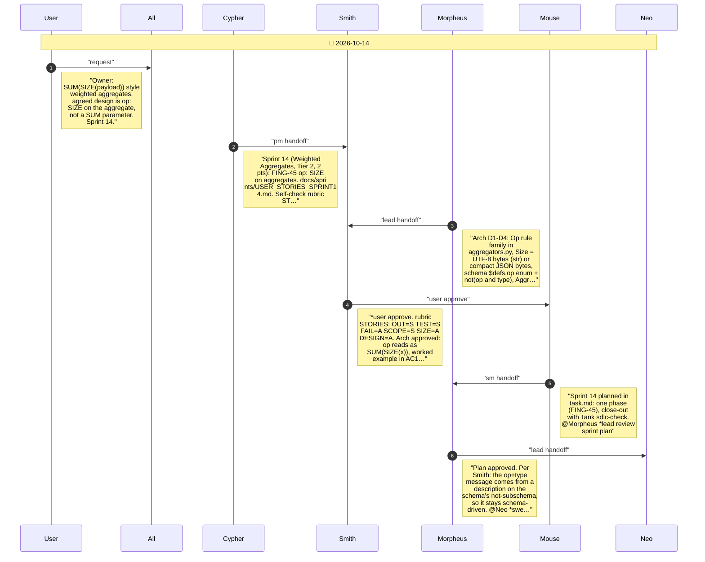
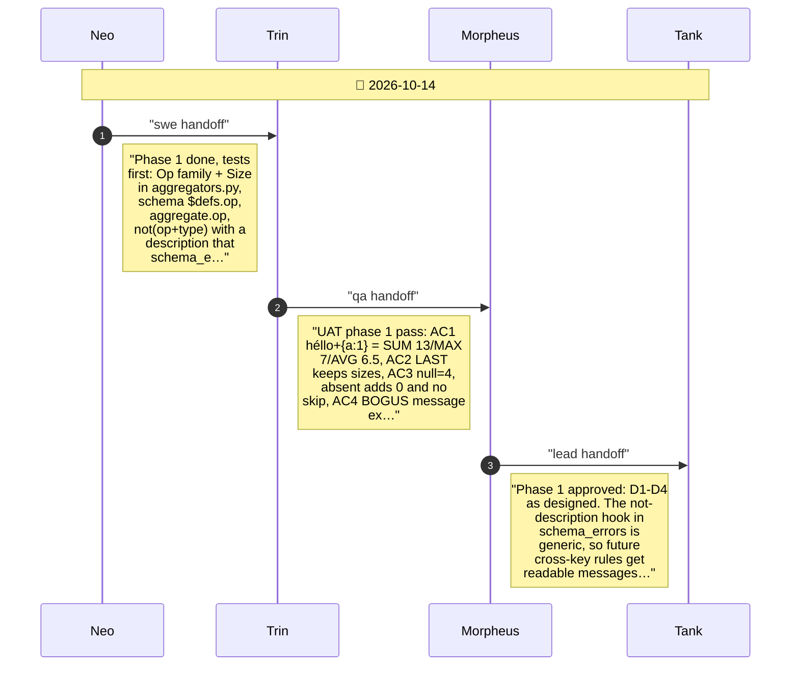
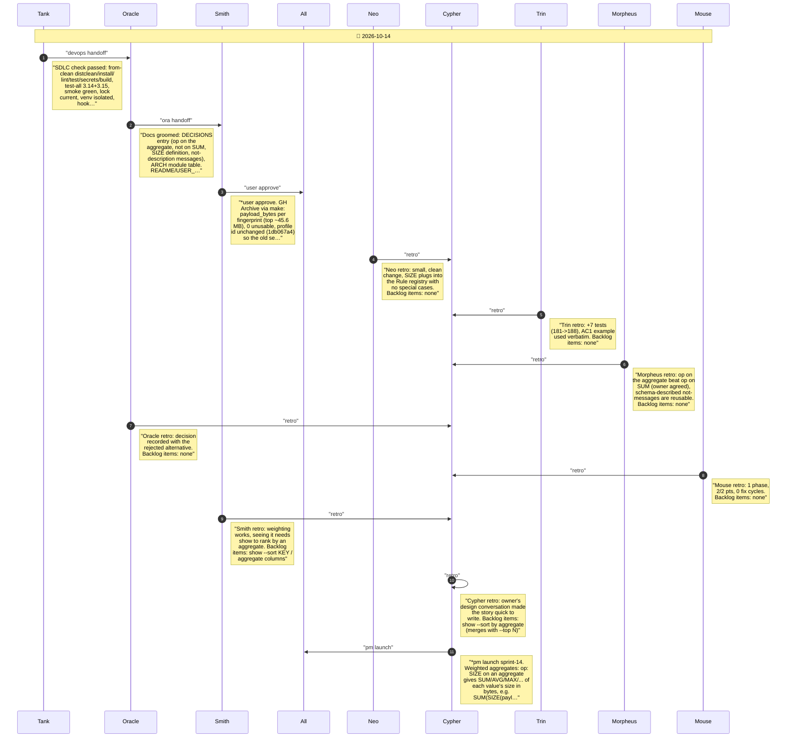

# CHAT_SPRINT_14 — Sprint Archive

## Summary

Sprint 14, Weighted Aggregates (Tier 2, 2 pts, 0 fix cycles). FING-45: an aggregate can carry op: SIZE, so every function aggregates each value's size in bytes (UTF-8 for text, compact JSON otherwise), e.g. SUM(SIZE(payload)). The owner agreed to put op on the aggregate rather than as a SUM parameter. op and type are exclusive. No release (mainline).

---

## Planning

---

## Phase 1

Phase 1: op: SIZE on aggregates (FING-45)

---

## Close

Close: Tank SDLC check, Oracle groom, Smith user test, retro, launch

