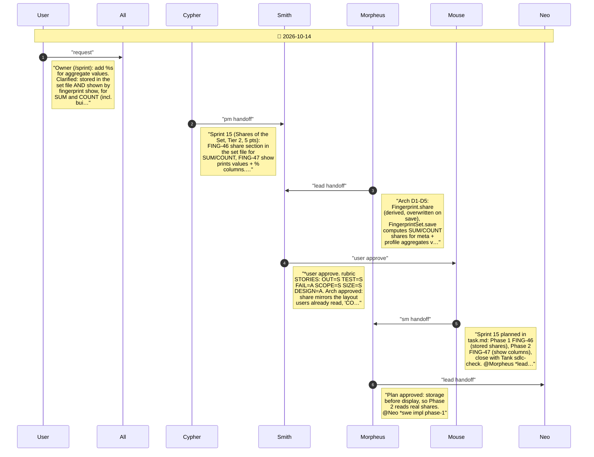
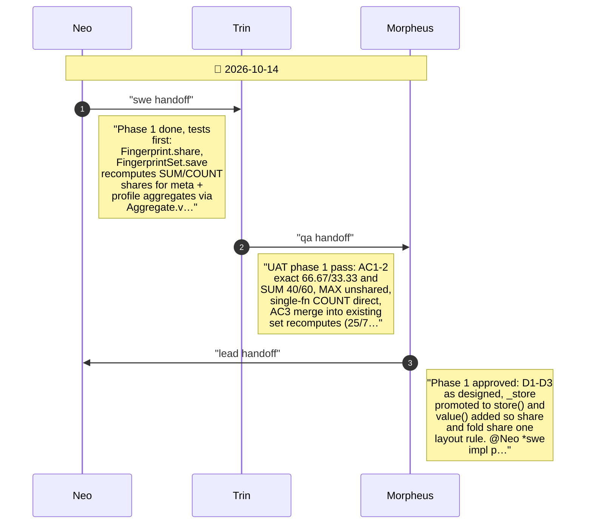
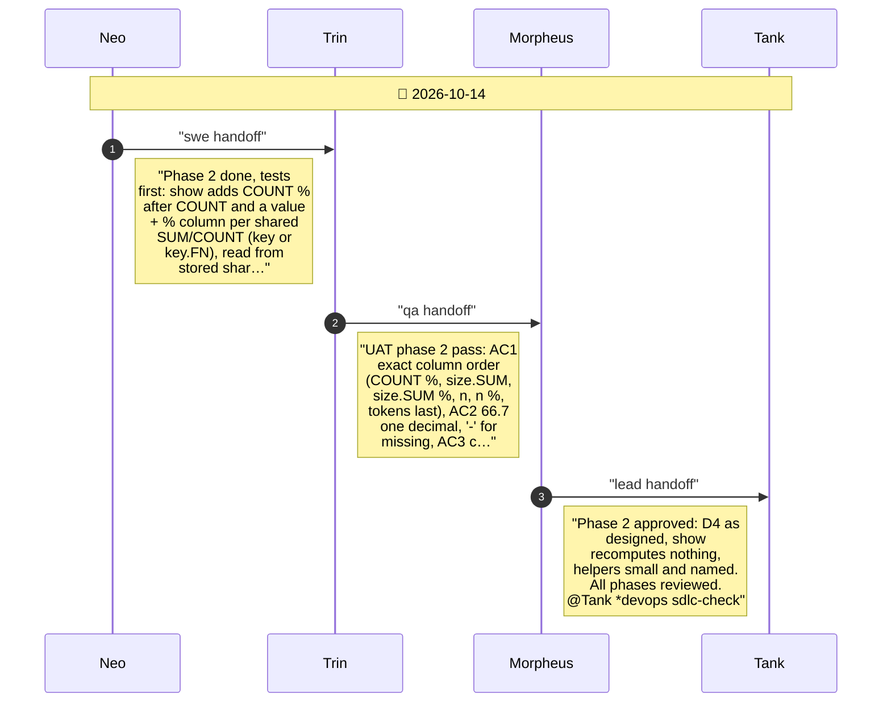
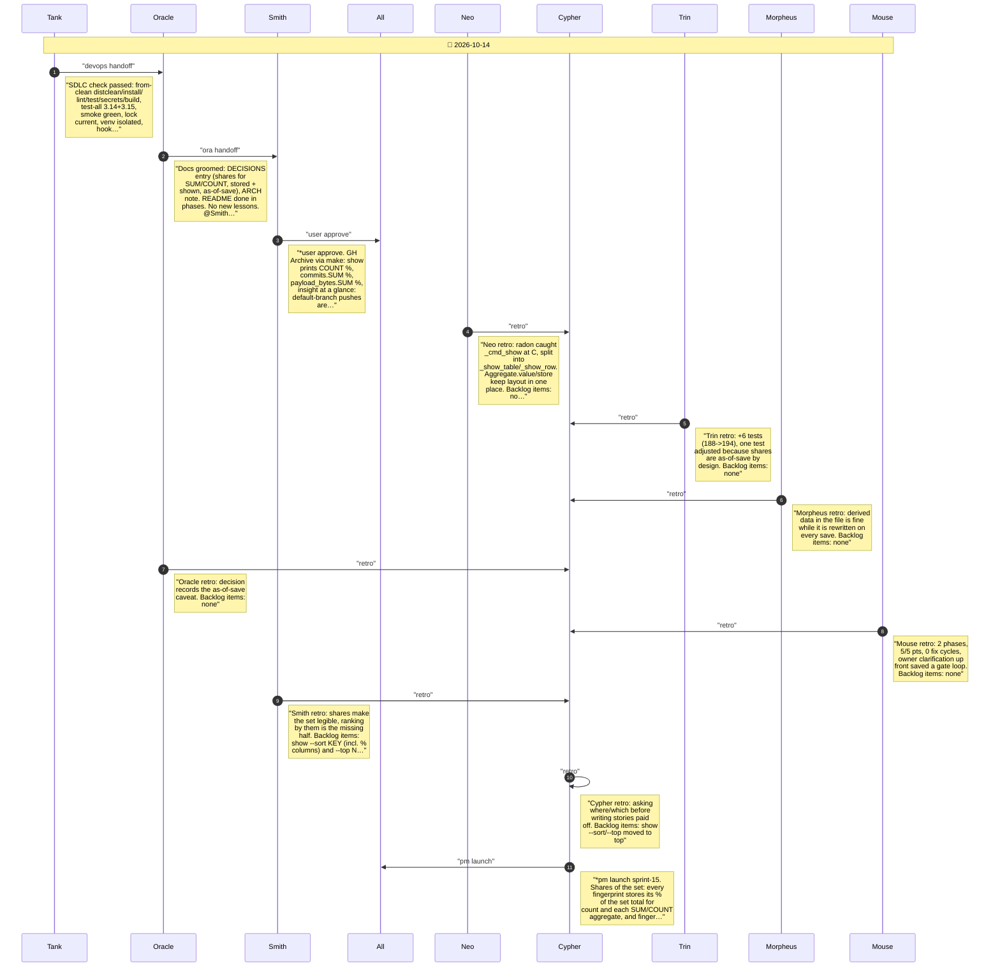

# CHAT_SPRINT_15 — Sprint Archive

## Summary

Sprint 15, Shares of the Set (Tier 2, 5 pts, 0 fix cycles). Owner asked for percentages of aggregate values; clarified as share of the set total for SUM and COUNT, stored and shown. FING-46: each fingerprint's share section in the set file, recomputed on every save. FING-47: fingerprint show prints COUNT % and a value + % column per SUM/COUNT aggregate. No release (mainline).

---

## Planning

---

## Phase 1

Phase 1: shares of SUM and COUNT stored in the set file (FING-46)

---

## Phase 2

Phase 2: shares in fingerprint show (FING-47)

---

## Close

Close: Tank SDLC check, Oracle groom, Smith user test, retro, launch

