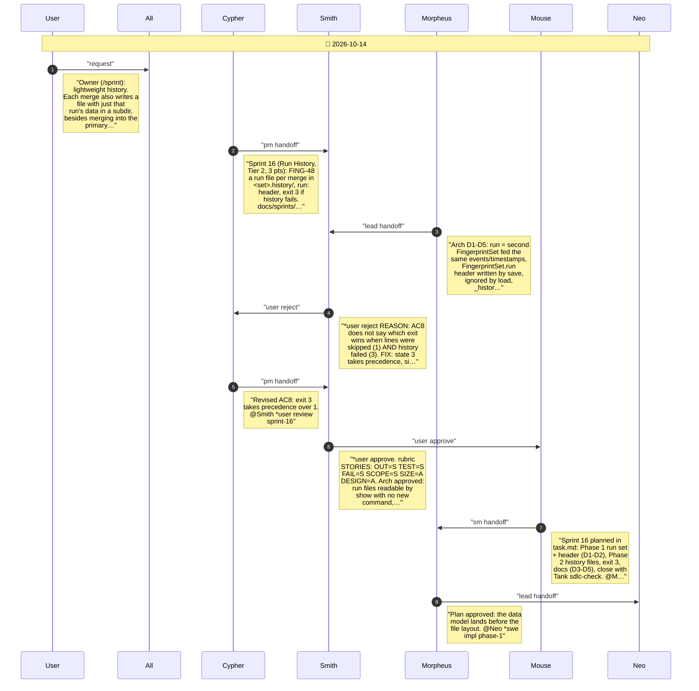
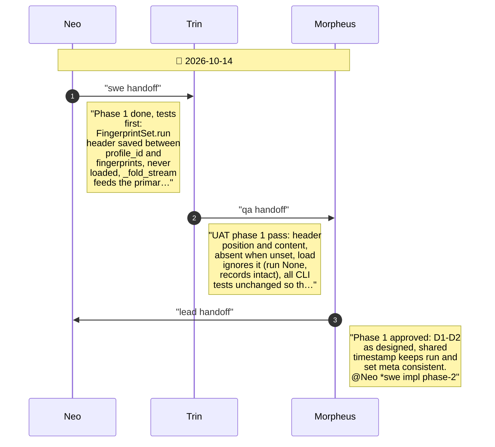
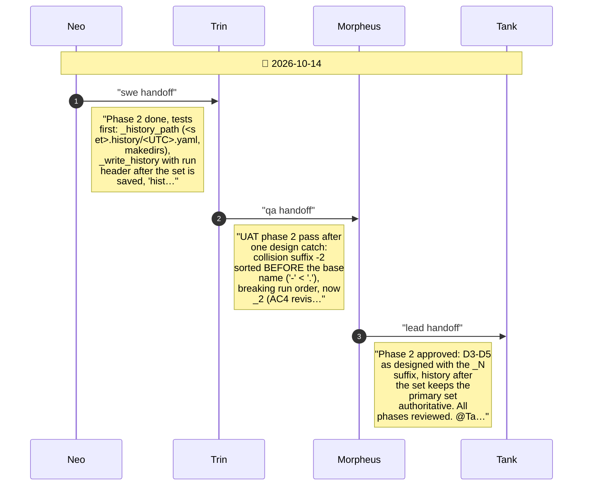
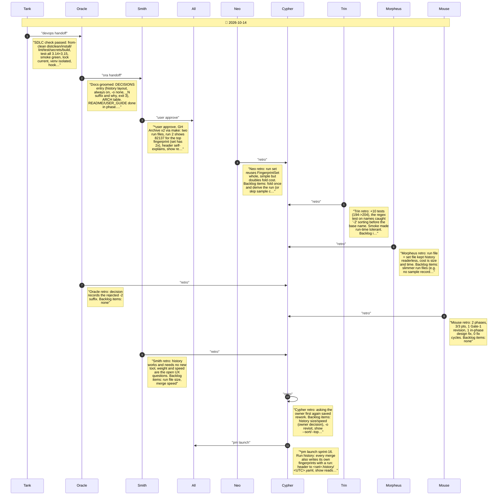

# CHAT_SPRINT_16 — Sprint Archive

## Summary

Sprint 16, Run History (Tier 2, 3 pts, 0 fix cycles). Owner asked for lightweight history; clarified: <set>.history/ beside the set, always on, -o kept without history. FING-48: each merge also writes that run's own set with a run: header to <set>.history/<UTC start>.yaml; same-second runs get _2 (UAT caught -2 sorting first); exit 3 if the history write fails. Findings: run files ~6 MB on GH Archive, merge ~1.7x slower. No release (mainline).

---

## Planning

---

## Phase 1

Phase 1: the run as a set - run header and per-run fold (FING-48 D1-D2)

---

## Phase 2

Phase 2: history files in <set>.history/, exit 3, docs (FING-48 D3-D5)

---

## Close

Close: Tank SDLC check, Oracle groom, Smith user test, retro, launch

