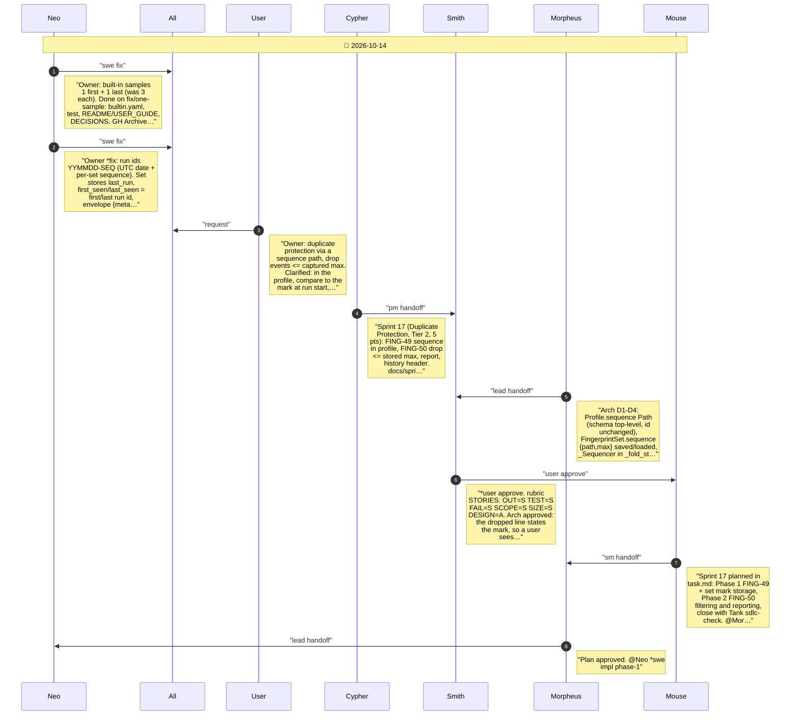
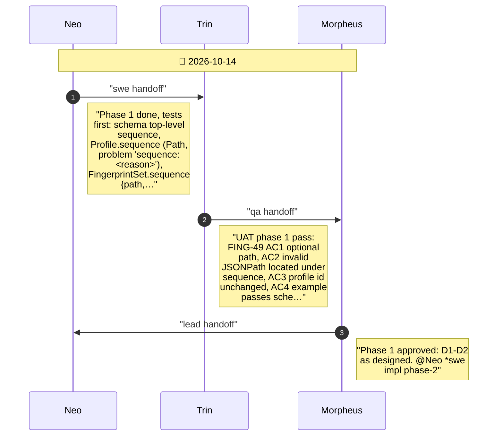
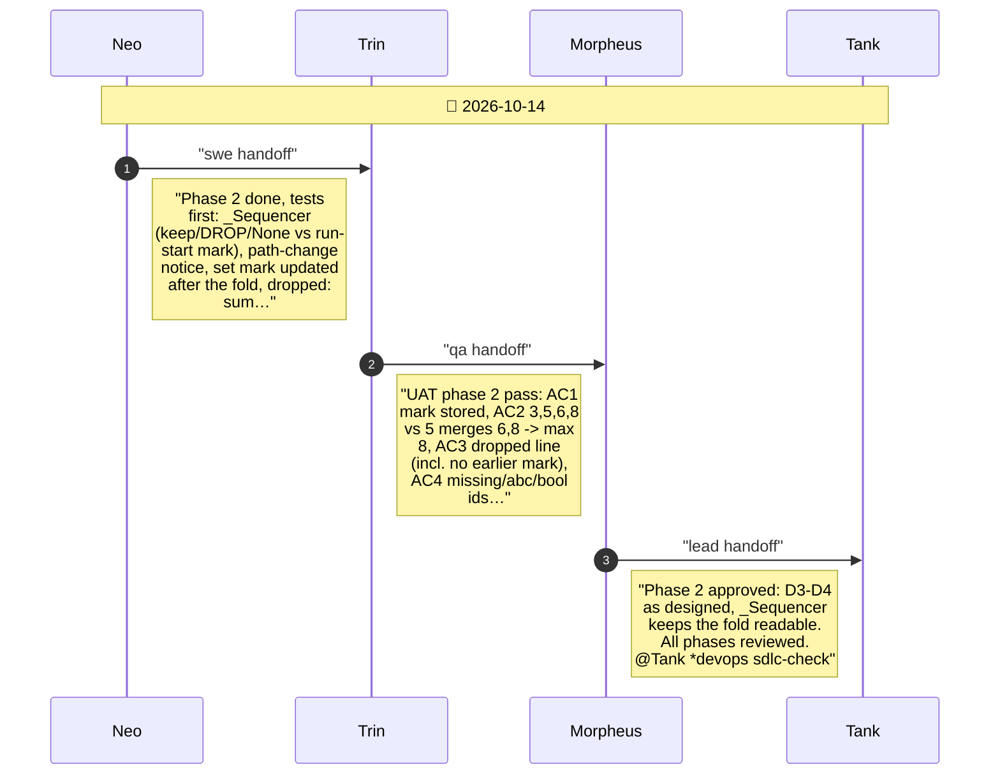
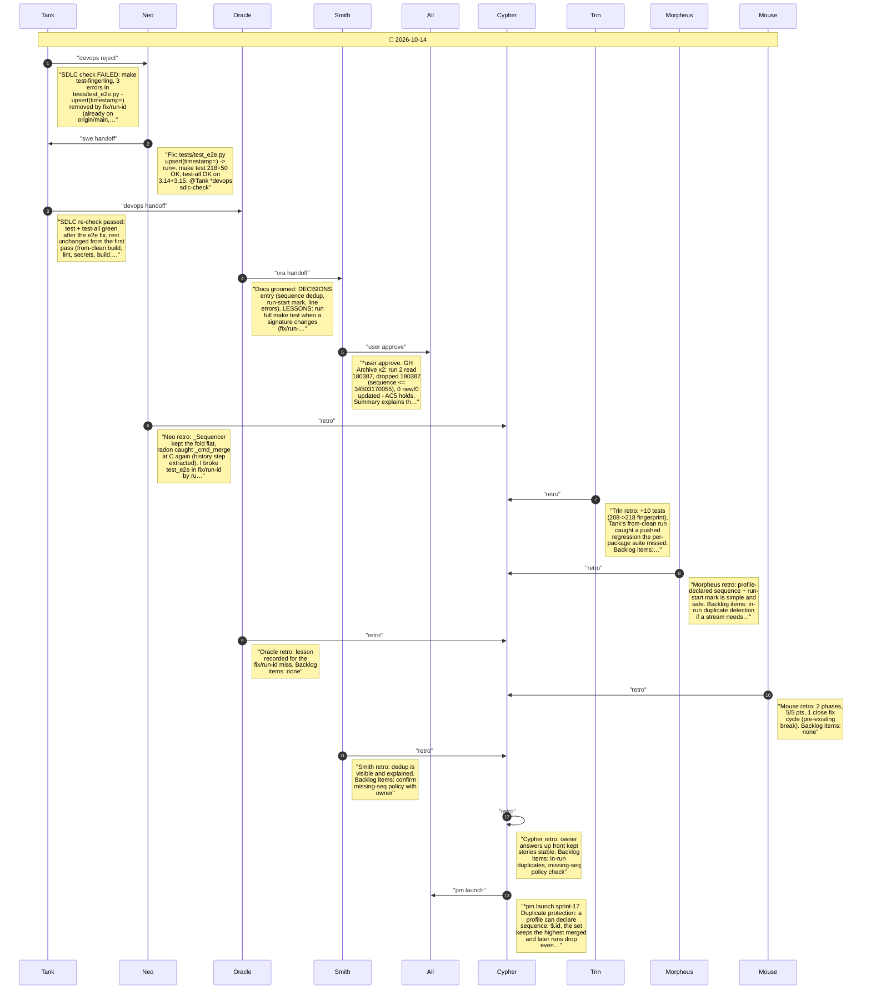

# CHAT_SPRINT_17 — Sprint Archive

## Summary

Sprint 17, Duplicate Protection (Tier 2, 5 pts). Owner asked for protection against re-runs and overlapping sources via a sequence path. FING-49: profile declares sequence: <JSONPath>. FING-50: the set keeps {path, max}; later runs drop events at or below the run-start mark; missing sequence is a line error. Tank's close check found tests/test_e2e.py broken by fix/run-id (already pushed); fixed, lesson recorded. No release (mainline).

---

## Planning

---

## Phase 1

Phase 1: sequence in the profile and the set (FING-49, D1-D2)

---

## Phase 2

Phase 2: drop already-merged events (FING-50, D3-D4)

---

## Close

Close: Tank SDLC check, Oracle groom, Smith user test, retro, launch

