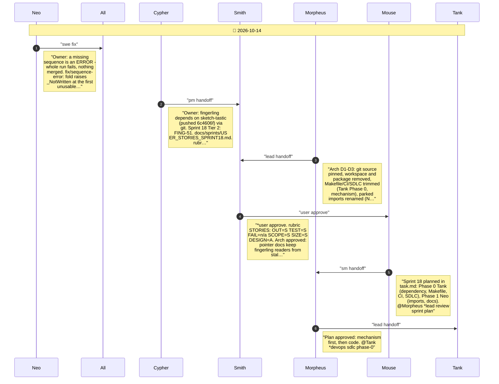
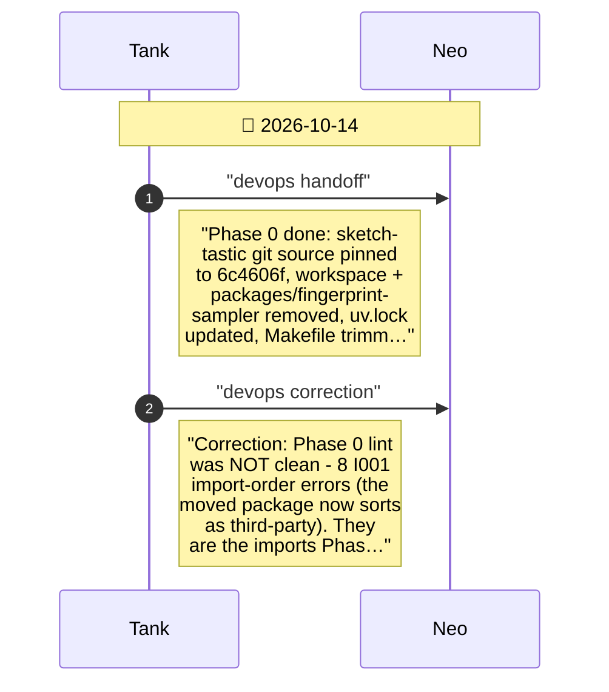
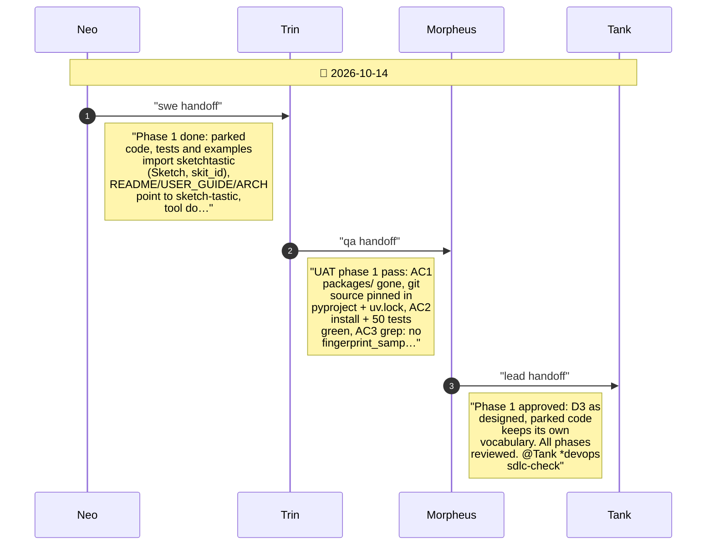
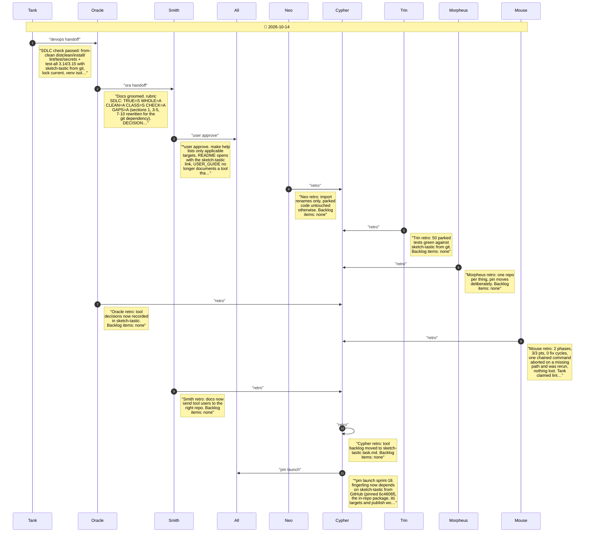

# CHAT_SPRINT_18 — Sprint Archive

## Summary

Sprint 18, Depend on sketch-tastic (Tier 2, 3 pts, 0 fix cycles). The fingerprint tool moved to drusifer/sketch-tastic (pushed 6c4606f). Phase 0 (Tank): git source pinned, workspace and packages/fingerprint-sampler removed, Makefile/CI trimmed, SDLC rewritten. Phase 1 (Neo): parked code imports sketchtastic; README/USER_GUIDE/ARCH point to sketch-tastic. No release.

---

## Planning

---

## Phase 0

Phase 0: depend on sketch-tastic via git; trim Makefile, CI, SDLC (FING-51 D1-D2)

---

## Phase 1

Phase 1: parked imports to sketchtastic; docs point to sketch-tastic (FING-51 D3)

---

## Close

Close: Tank SDLC check, Oracle groom, Smith user test, retro, launch

