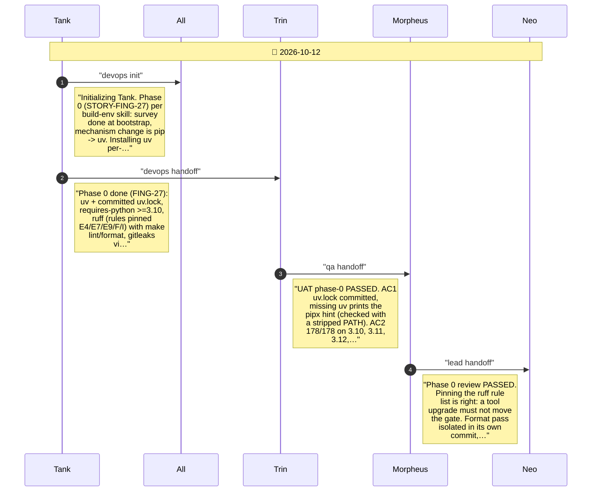
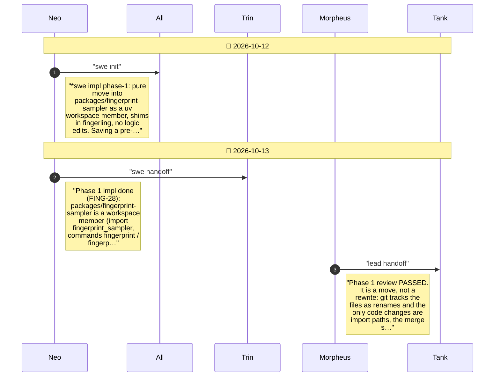
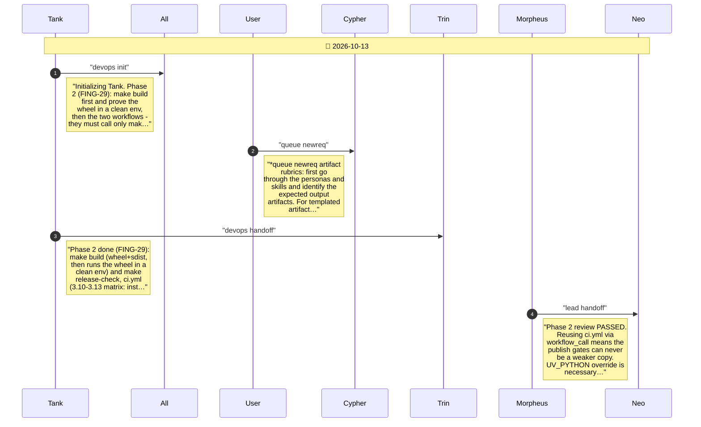
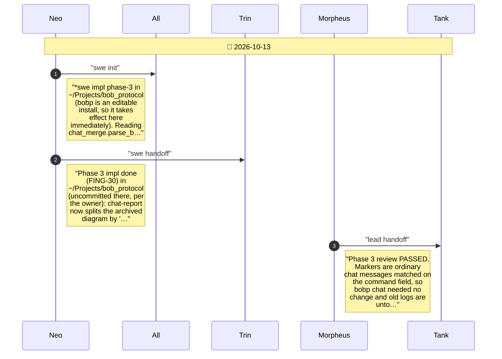
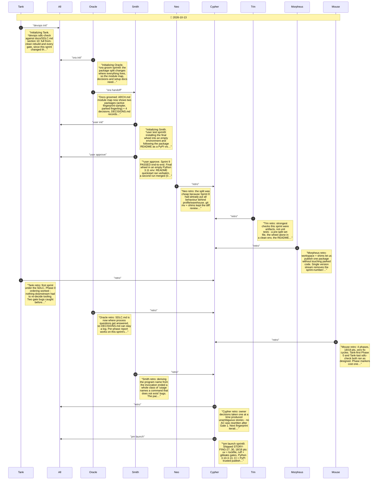

# CHAT_SPRINT_9 — Sprint Archive

## Summary

Sprint 9 - Fingerprint Package + SDLC Tooling (2026-10-12/13). First sprint run under docs/SDLC.md, on branch sprint-9. Delivered STORY-FING-27..30 (18/18 pts): uv with a committed lockfile, ruff and gitleaks gates, Python 3.10-3.13, CI and PyPI trusted-publishing workflows, the fingerprint tool split out as the fingerprint-sampler package (command: fingerprint merge), and this per-phase chat report. Planning also contains the pre-sprint build bootstrap and SDLC decisions. Released as fingerprint-sampler 0.1.0 (tag v0.1.0), merged to main, not pushed.

---

## Planning

```mermaid
%%{init: {"sequence": {"messageFontSize": 14, "noteFontSize": 18, "actorFontSize": 14}}}%%
sequenceDiagram
    autonumber
    participant Oracle
    participant All
    participant User
    participant Bob
    participant Tank
    participant Mouse
    participant Cypher
    participant Smith
    participant Morpheus
    Note over Oracle,Morpheus: 📅 2026-10-12
    Oracle->>All: "ora report"
    Note right of Oracle: "Sprint 8 chat archived<br/>to agents/chat_archive/C<br/>HAT_SPRINT_8.md (also<br/>contains the never-<br/>archived Sprint 1-7 log)<br/>and CHAT.md reset for<br/>the…"
    User->>Bob: "request"
    Note right of User: "Add a new skill for Tank<br/>to set up build envs for<br/>different languages<br/>(Python pyproject.toml,<br/>JavaScript package.json,<br/>etc). Tank does the…"
    Bob->>All: "prompt init"
    Note right of Bob: "Initializing Bob (Prompt<br/>Engineer). Creating a<br/>build-env skill for Tank<br/>per User request:<br/>initial build-<br/>environment setup per<br/>language conv…"
    Bob->>Tank: "prompt handoff"
    Note right of Bob: "New shared skill:<br/>agents/skills/build-env<br/>(triggers *devops<br/>bootstrap / *devops<br/>build-env). Tank does<br/>initial build-env setup<br/>per language…"
    User->>Tank: "request"
    Note right of User: "go for it - run @Tank<br/>*devops bootstrap python<br/>on fingerling"
    Tank->>All: "devops init"
    Note right of Tank: "Initializing Tank<br/>(DevOps). *devops<br/>bootstrap python,<br/>following the build-env<br/>skill: survey first,<br/>because the repo already<br/>has a requireme…"
    Tank->>All: "devops handoff"
    Note right of Tank: "Bootstrap done:<br/>pyproject.toml is the<br/>manifest (deps, demo/dev<br/>extras, 'fingerling'<br/>console script), .venv<br/>is isolated,<br/>requirements.txt is…"
    User->>Bob: "request"
    Note right of User: "OK to the loop edits.<br/>Also add a Tank check at<br/>sprint close so we don't<br/>drift from Tank's SDLC.<br/>Add to Tank's bootstrap<br/>skill that Tank is…"
    Bob->>All: "prompt init"
    Note right of Bob: "Initializing Bob. Wiring<br/>SDLC ownership into the<br/>loops: Tank defines<br/>docs/SDLC.md (build-env<br/>skill), sprint start is<br/>blocked without it, Ta…"
    User->>Bob: "request"
    Note right of User: "Come up with a basic<br/>template for the SDLC<br/>procedures document. We<br/>can have language or<br/>platform specific ones<br/>to make it easy."
    User->>Bob: "request"
    Note right of User: "Tank's SDLC doc will<br/>become the source of<br/>truth for change<br/>management for the<br/>entire project."
    Bob->>Tank: "prompt handoff"
    Note right of Bob: "SDLC wiring done. Tank<br/>owns docs/SDLC.md as the<br/>source of truth for<br/>change management<br/>(AGENTS.md guideline 4).<br/>build-env skill: SDLC<br/>sectio…"
    Tank->>All: "devops init"
    Note right of Tank: "Initializing Tank.<br/>*devops sdlc: writing<br/>docs/SDLC.md from templa<br/>tes/SDLC.python.md. The<br/>environment was verified<br/>from clean earlier<br/>today…"
    Tank->>All: "devops handoff"
    Note right of Tank: "docs/SDLC.md written<br/>from the Python<br/>template: toolchain,<br/>setup, make targets,<br/>dependency process,<br/>gates, change<br/>management, release, CI,<br/>d…"
    User->>Bob: "request"
    Note right of User: "Put the SDLC templates<br/>with the existing ones<br/>(agents/templates) so we<br/>don't bloat the skill."
    Bob->>All: "prompt update"
    Note right of Bob: "Moved the SDLC templates<br/>to agents/templates/ as<br/>_template_SDLC.md, _temp<br/>late_SDLC.python.md, _te<br/>mplate_SDLC.javascript.m<br/>d, matching the ex…"
    User->>All: "decision"
    Note right of User: "Decisions (Q&A): branch<br/>per sprint, agents<br/>branch/commit/merge<br/>(push stays with User),<br/>Conventional Commits,<br/>SemVer bump on change,<br/>ruff +…"
    Tank->>All: "devops sdlc"
    Note right of Tank: "SDLC revised from the<br/>owner's decisions:<br/>sprint-<N> branches,<br/>agents commit and merge<br/>(never push),<br/>Conventional Commits,<br/>SemVer bump + tag…"
    Mouse->>Cypher: "sm start"
    Note right of Mouse: "Sprint 9 start. Stage 0<br/>SDLC gate: docs/SDLC.md<br/>present - pass. Per SDLC<br/>section 6, created<br/>branch sprint-9 from a<br/>clean main (baseline<br/>0b1…"
    Cypher->>Smith: "pm handoff"
    Note right of Cypher: "Sprint 9 stories<br/>drafted: docs/USER_STORI<br/>ES_SPRINT9.md, 18 pts.<br/>FING-27 reproducible<br/>gated env (uv, 3.10+,<br/>ruff, gitleaks), FING-28<br/>fingerp…"
    Smith->>Morpheus: "user approve"
    Note right of Smith: "*user approve Gate 1.<br/>Stories are outcome-<br/>first and testable.<br/>Added FING-28 AC9<br/>(package README<br/>quickstart must work<br/>pasted into a fresh en…"
    Morpheus->>Smith: "lead handoff"
    Note right of Morpheus: "Sprint 9 arch D1-D7 in d<br/>ocs/USER_STORIES_SPRINT9<br/>.md. uv workspace, 2<br/>packages: fingerling<br/>(parked, private) +<br/>packages/fingerprint-<br/>sampler…"
    Smith->>Mouse: "user approve"
    Note right of Smith: "*user approve Gate 2.<br/>'fingerprint merge'<br/>reads as what it does<br/>and leaves room for<br/>show/report, keeping<br/>'fingerling fingerprint'<br/>as an ali…"
    Mouse->>Morpheus: "sm handoff"
    Note right of Mouse: "Sprint 9 planned in<br/>task.md: Phase 0 Tank<br/>build env (FING-27)<br/>first per the new Phase<br/>0 rule, Phase 1 Neo<br/>package split (FING-28),<br/>Phase 2…"
    Morpheus->>Tank: "lead handoff"
    Note right of Morpheus: "Sprint plan approved:<br/>order follows the<br/>dependency chain (env -><br/>split -> CI), each phase<br/>leaves lint+test green,<br/>and Phase 3 is<br/>independen…"
```

---

## Phase 0

Build environment (STORY-FING-27): move to uv with a committed lockfile, support Python 3.10-3.13, add ruff lint/format and gitleaks as gates, delete the leftover build files.

---

## Phase 1

Package split (STORY-FING-28): move the fingerprint tool into its own installable package, packages/fingerprint-sampler, with the command 'fingerprint merge'. Parked fingerling modules keep working through re-export shims.

---

## Phase 2

CI and publishing (STORY-FING-29): make build for the fingerprint-sampler package, a GitHub Actions workflow running the same make gates on every push, and a tag-triggered workflow that publishes to PyPI by trusted publishing.

---

## Phase 3

Per-phase chat report (STORY-FING-30): teach bobp chat-report, in ~/Projects/bob_protocol, to split the sprint archive into sections from these phase-marker messages - sprint description first, then each phase's description and its own chat diagram.

---

## Close

Close-out: Tank's SDLC conformance check, Oracle's documentation groom, Smith's end-to-end user test, retrospective, launch, then merge to main and tag.

