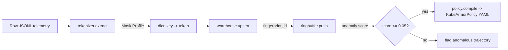
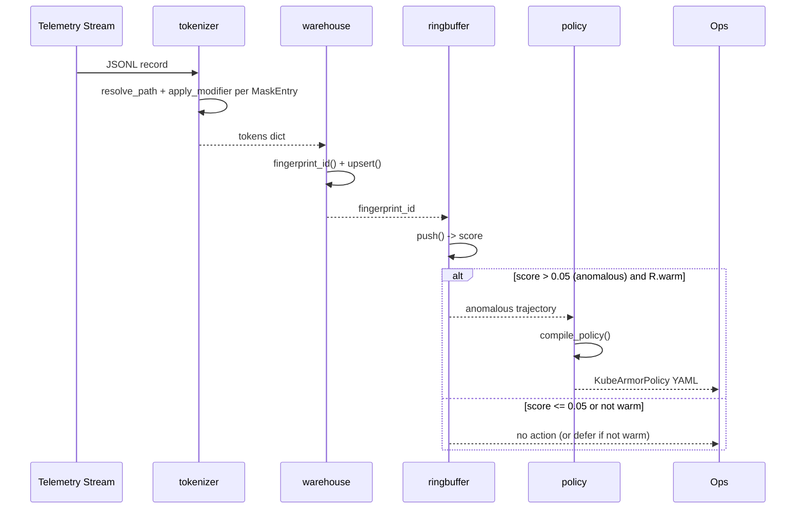

# Project Fingerling — POC Architecture

Maintained by Morpheus. Covers only the POC scope defined in `docs/USER_STORIES.md`
(STORY-FING-01..04). Infra pieces (webhook server, sandbox provisioning, live GitOps
commit/PR automation, cluster deployment) are documented for context but **not** implemented
in this sprint — see §7.

## 1. System Overview

Four independent, composable pure-Python library modules form the POC's fingerprinting core.
Each maps 1:1 to a user story so phases (Mouse) and stories stay aligned:

| Module | Story | Responsibility |
|---|---|---|
| `fingerling/tokenizer.py` | STORY-FING-01 | JSONPath extraction + modifier engine → stable token dict |
| `fingerling/warehouse.py` | STORY-FING-02 | Alphabetical serialize + MD5 fold + stateful upsert |
| `fingerling/ringbuffer.py` | STORY-FING-03 | FIFO sliding-window N-gram anomaly matcher |
| `fingerling/policy.py` | STORY-FING-04 | KubeArmorPolicy YAML manifest compiler |

No module depends on a live filesystem, network, or cluster. Any persistence (the
`fingerprints.yaml` warehouse) is injected as a path/stream so tests run fully in-memory.

## 2. Architectural Principles

- **No new third-party dependencies.** JSONPath resolution is hand-rolled (dot + bracket-index
  only — the subset the spec actually uses: `$.a.b`, `$.a.b[0].c`). Avoids pulling in
  `jsonpath-ng` for a POC. `PyYAML` (already available in the environment) is the only
  non-stdlib dependency, used only in `warehouse.py` and `policy.py` for YAML I/O.
- **Pure functions / small stateful classes.** Each story maps to one class or function group
  with no hidden global state — easy to unit test in isolation (Neo/Trin need this for TDD).
- **Stable contracts over inferred behavior.** Where the source spec was ambiguous (flagged by
  Smith at Gate 1), the architecture resolves ambiguity with an explicit parameter rather than
  inferred/magic behavior (see §7 Decisions).

## 3. Component Diagram



## 4. Class & Data Structures

### 4.1 `tokenizer.py` (STORY-FING-01)

```python
@dataclass(frozen=True)
class MaskEntry:
    key: str          # stable output key, e.g. "application_binary"
    path: str          # dot-path, e.g. "$.process_exec.process.binary"
    modifier: str      # e.g. "DEFAULT" | "IS_PRESENT" | "IS_NULL" | "IN_RANGE(-999,0)" | "ANY(80,443)"

def resolve_path(record: dict, path: str) -> Any | _MISSING: ...
def apply_modifier(value, modifier: str) -> str: ...
def tokenize(record: dict, mask_profile: list[MaskEntry]) -> dict[str, str]: ...
def parse_jsonl(jsonl_text: str) -> list[dict]: ...  # added during Phase 1 UAT, see §7 decision 6
```

Modifier registry is a plain `dict[str, Callable]` keyed by modifier name, parsed by splitting
`NAME(args)` on the first `(`. Unknown modifier name -> `ValueError` at profile-load time (fail
fast, not at telemetry-processing time). Missing/null path -> the modifier receives a sentinel
`_MISSING`; `IS_PRESENT`/`IS_NULL` handle it explicitly, all other modifiers return `"FALSE"`
when given `_MISSING` per STORY-01 AC4 (no exceptions during processing).

### 4.2 `warehouse.py` (STORY-FING-02)

```python
def fingerprint_id(tokens: dict[str, str]) -> str:
    # sort by key, join "key:value|key:value...", md5 hexdigest

@dataclass
class FingerprintRecord:
    total_occurrences: int
    first_seen: str
    last_seen: str
    min_duration_ms: float
    max_duration_ms: float
    samples: list[dict]     # ring, capped at 3 (oldest dropped)

class Warehouse:
    def upsert(self, tokens: dict[str, str], duration_ms: float, raw_record: dict) -> str:
        """Returns the fingerprint_id. Match -> update counters. Drift -> new record + sample."""
    def load(self, path: str) -> None: ...
    def save(self, path: str) -> None: ...
```

Sample ring cap of 3 implemented as a plain list with `list.append` + truncate from the front
(`samples = (samples + [row])[-3:]`) — no need for `collections.deque` since we serialize to
YAML on save. **Clarified during Phase 2 UAT:** the ring grows on every `upsert()` call, not
only on Drift — this is the only reading under which the story's own Verification Task
("dropping/rotating older rows") is testable, since Drift alone only ever appends once per
record.

### 4.3 `ringbuffer.py` (STORY-FING-03)

```python
class SlidingWindowMatcher:
    def __init__(self, n: int, whitelist: set[tuple[str, ...]]): ...
    @property
    def warm(self) -> bool:
        """True once the window has filled to depth n at least once."""
    def push(self, fingerprint_id: str) -> float:
        """Returns 0.0 (no anomaly / warm-up) or 1.0 (anomalous n-gram)."""
```

**Resolves Smith Gate-1 note:** the public `push()` contract stays exactly as specified in
STORY-FING-03 AC4 (`0.0`/`1.0`, warm-up returns `0.0`) — that's the caller-facing behavioral
contract from the source BRD and Trin will test it verbatim. Visibility of System Status is
restored via the separate `warm` property: any caller that cares whether a `0.0` means "verified
clean" vs. "not enough data yet" checks `matcher.warm` before trusting the score. The enforcement
gate (out of POC scope, but documented for the next sprint) is required to check `warm` before
treating a `0.0` as a deployment-approval signal.

### 4.4 `policy.py` (STORY-FING-04)

```python
def compile_policy(
    workload_name: str,
    match_labels: dict[str, str],
    anomalous_trajectory: str,
    namespace: str = "default",
    action: Literal["Block", "Post"] = "Block",
) -> str:
    """Returns a YAML string: a syntactically valid KubeArmorPolicy CRD."""
```

**Resolves Smith Gate-1 note:** STORY-FING-04 AC3's "defaults to Block or Post based on target
spec" is replaced with an explicit `action` parameter defaulting to `"Block"`. No inference from
implicit target-spec fields — the caller (future GitOps automation, out of POC scope) decides
`Post` (audit-only) explicitly when it wants dry-run behavior. Removes ambiguity Neo would
otherwise have to guess at.

## 5. Sequence & Interaction Flows



## 6. Technical Stack

- **Language:** Python 3.13 (matches environment; no version-specific syntax beyond 3.10+
  `match`/`Literal` usage, kept optional to stay conservative).
- **Stdlib:** `hashlib` (MD5), `dataclasses`, `collections.deque` (only inside ringbuffer's
  internal window, not the warehouse sample ring), `re` (path/modifier parsing).
- **Third-party:** `PyYAML` — warehouse persistence + policy manifest rendering. Already present
  in the dev environment; add to `requirements.txt` (currently absent — Neo creates it in Phase 1).
- **Test runner:** stdlib `unittest`, discovered via `make test` (`python -m unittest discover -s tests`)
  — confirms package layout must be `fingerling/` (importable) + `tests/` at repo root.

## 7. Decisions Log (for Oracle)

1. **No JSONPath library dependency** — hand-rolled resolver limited to the dot/bracket-index
   subset actually used by the spec. Rationale: POC scope, avoid dependency weight.
2. **Ring-buffer warm-up visibility** — added `SlidingWindowMatcher.warm` property alongside the
   spec-mandated `push()` 0.0/1.0 contract. Resolves Smith Gate-1 HCI note without changing the
   external contract Trin will test against.
3. **KubeArmorPolicy `action` is an explicit caller parameter**, default `"Block"` — resolves
   Smith Gate-1 ambiguity note on STORY-FING-04 AC3.
4. **Warehouse sample ring cap = 3`, implemented as list slicing, not `deque`** — the warehouse is
   YAML-serialized on save; `deque` doesn't serialize cleanly with PyYAML, plain list does.
5. **Package layout:** `fingerling/{tokenizer,warehouse,ringbuffer,policy}.py` + `tests/test_*.py`,
   matching the existing `make test` target (`unittest discover -s tests`). No `src/` layer for
   POC — add if/when this becomes a distributed package.
6. **`parse_jsonl()` added to tokenizer.py during Phase 1 UAT** — the original architecture only
   specified `tokenize(record: dict, ...)`, omitting the literal "accepts a JSONL input string"
   entry point STORY-FING-01 AC1 requires. Trin caught the gap at UAT; Neo added a 4-line
   `json.loads`-per-line wrapper. Documented here so ARCH.md stays the accurate source of truth.

## 8. Refactoring Status & Technical Debt

None yet — greenfield POC. Anticipated post-POC debt: the hand-rolled path resolver will need
to grow (wildcards, recursive descent) if a future sprint needs full JSONPath; flagged here so
it isn't silently reinvented under time pressure later.
