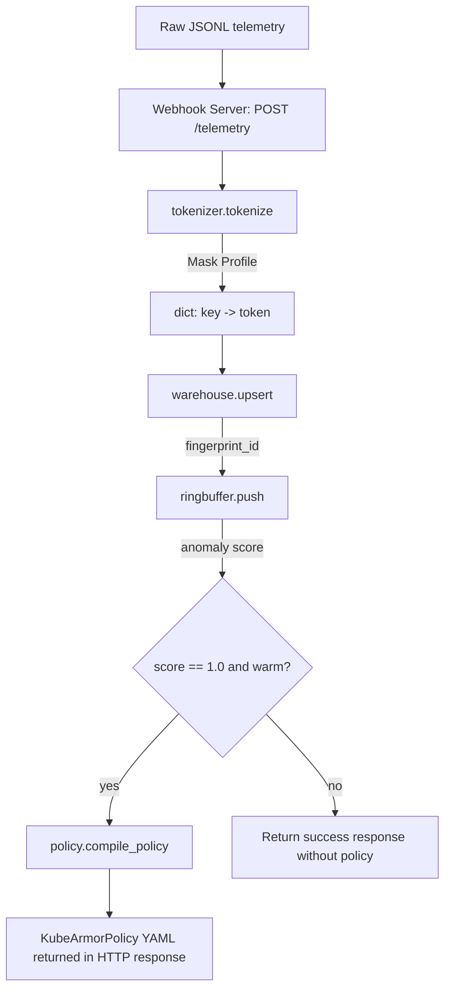

# Project Fingerling — Architecture

Maintained by Morpheus. Module map current as of Sprint 8 (2026-10-12); sections 3-4 detail the
fingerprinting core. Per-sprint design rationale lives in `docs/USER_STORIES_SPRINT<N>.md`.

## 1. System Overview

Fingerling is a set of composable Python library modules in two groups.

**Fingerprint sampling tool** — general-purpose, works on any JSONL event stream:

| Module | Story | Responsibility |
|---|---|---|
| `fingerling/tokenizer.py` | FING-01, -07, -23 | JSONPath extraction (via `python-jsonpath`, full syntax) + modifier engine |
| `fingerling/aggregators.py` | FING-25 | Per-fingerprint `SUM`/`AVG`/`MIN`/`MAX`/`LAST(n)` state, mergeable across runs |
| `fingerling/warehouse.py` | FING-02, -05, -25 | The fingerprint set: MD5 IDs, stateful upsert, versioned atomic YAML file, baseline whitelist helper |
| `fingerling/profile.py` | FING-24 | YAML profile loading + validation, `profile_id` |
| `fingerling/cli.py`, `__main__.py` | FING-26 | `python -m fingerling fingerprint` — merge a stream into a set |

**Detection and response pipeline** — consumes fingerprint IDs from the tool above:

| Module | Story | Responsibility |
|---|---|---|
| `fingerling/ringbuffer.py` | FING-03 | FIFO sliding-window N-gram anomaly matcher |
| `fingerling/policy.py` | FING-04, -06, -22 | KubeArmorPolicy YAML compiler (`block_pattern` adds `matchPattern`) |
| `fingerling/server.py` | FING-08 | stdlib HTTP webhook telemetry ingestion server |
| `fingerling/gitops.py` | Sprint 3 | Commit/merge compiled policies into a GitOps repo (optional GPG signing) |
| `fingerling/sandbox.py`, `vaccine.py` | Sprint 4 | Controlled-exposure sandbox and baseline/exploit replay |
| `fingerling/capture.py` | — | bpftrace `execve` capture → Tetragon-shaped JSONL |

The sampling tool has no dependency on the pipeline group. N-gram analysis is deliberately a
later stage: it sees only the fingerprint IDs `Warehouse.upsert()` returns.

## 2. Architectural Principles

- **Few third-party dependencies.** `PyYAML` and, since Sprint 8, `python-jsonpath` (pure Python, no transitive deps) for full JSONPath syntax. The hand-rolled resolver from the POC is gone. Python's stdlib `http.server` is used for webhook ingestion. Dependencies are declared in `pyproject.toml` and install into a project `.venv` via `make install`.
- **Stable contracts over inferred behavior.** Ambiguities are resolved with explicit parameters.
- **Deterministic and Stable Tokens.** Token shape depends only on how many values a path selects: none → "missing", one → that value, several → each tokenized, deduplicated, sorted and comma-joined.
- **One fold path.** Aggregator state is plain data that is loaded and folded further; a set built over many runs equals one built in a single pass by construction.

## 3. Component Diagram



## 4. Class & Data Structures

### 4.1 `tokenizer.py` (STORY-FING-01, -07, -23)

```python
@dataclass(frozen=True)
class MaskEntry:
    key: str
    path: str
    modifier: str

def compile_path(path: str) -> jsonpath.JSONPath: ...   # cached; ValueError if empty/invalid
def find_values(record: Any, path: str) -> list[Any]: ...
def validate_modifier(modifier: str) -> None: ...
def apply_modifier(value, modifier: str) -> str: ...     # one value
def tokenize_values(values: list, modifier: str) -> str: ...  # match-count rule
def tokenize(record: dict, mask_profile: list[MaskEntry]) -> dict[str, str]: ...
def parse_jsonl(jsonl_text: str) -> list[dict]: ...
```

Paths use full JSONPath (RFC 9535 plus the `[?(@.x == 1)]` filter form): filters, slices, unions,
negative indexes, recursive descent. Empty/missing matches tokenize to `"FALSE"`/`"NULL"`, never
raising.

### 4.2 `aggregators.py`, `warehouse.py`, `profile.py` (STORY-FING-02, -05, -24, -25)

```python
@dataclass(frozen=True)
class AggregateEntry:
    key: str
    path: str
    fns: tuple[str, ...]            # e.g. ("MIN", "MAX", "LAST(3)")

def make_entry(key, path, fns) -> AggregateEntry: ...          # validated
def update(state: dict, entry: AggregateEntry, record) -> int: ...  # returns values skipped

def fingerprint_id(tokens: dict[str, str]) -> str: ...

@dataclass
class FingerprintRecord:
    tokens: dict[str, str]
    total_occurrences: int
    first_seen: str
    last_seen: str
    aggregates: dict[str, dict]     # aggregate key -> {"MIN": .., "AVG": {avg, sum, count}, "LAST": [..]}

class Warehouse:
    def __init__(self, aggregates: Sequence[AggregateEntry] = (), profile_id: str | None = None): ...
    def upsert(self, tokens: dict[str, str], record: Any, timestamp: str | None = None) -> str: ...
    def load(self, path: str, force: bool = False) -> None: ...   # ProfileMismatchError unless force
    def save(self, path: str) -> None: ...                         # temp file + os.replace

TELEMETRY_AGGREGATES   # duration_ms MIN/MAX + LAST(3) raw events, for the telemetry pipeline

@dataclass(frozen=True)
class Profile:
    fields: tuple[MaskEntry, ...]
    aggregates: tuple[AggregateEntry, ...]
    profile_id: str                 # property; MD5 over fields only

def load_profile(path: str) -> Profile: ...   # ProfileError names file + entry

def build_whitelist(records, mask_profile, n, warehouse=None) -> set[tuple[str, ...]]: ...
```

Aggregator state is keyed by function name, so changing `n` in `LAST(n)` keeps collected
samples. Numeric functions accept ints, floats and numeric strings; other values are skipped and
counted in `Warehouse.skipped_values`. The set file is version 1 (`version`, `profile_id`,
`fingerprints`); pre-Sprint-8 files are rejected with a clear error.

### 4.3 `ringbuffer.py` (STORY-FING-03)

```python
class SlidingWindowMatcher:
    def __init__(self, n: int, whitelist: set[tuple[str, ...]]): ...
    @property
    def warm(self) -> bool: ...
    def push(self, fingerprint_id: str) -> float: ...
```

### 4.4 `policy.py` (STORY-FING-04, STORY-FING-06)

```python
def compile_policy(
    workload_name: str,
    match_labels: dict[str, str],
    anomalous_trajectory: str | tuple[str, ...],
    namespace: str = "default",
    action: Literal["Block", "Post"] = "Block",
    block_pattern: str | None = None,
) -> str:
    """Compile KubeArmorPolicy CRD. anomalous_trajectory accepts tuples directly."""
```

### 4.5 `server.py` (STORY-FING-08)

```python
class TelemetryHTTPRequestHandler(BaseHTTPRequestHandler):
    """Handles POST /telemetry requests in-process."""
```
- Ingests JSONL payload batches.
- Invokes the pipeline sequentially.
- Responds with processing statistics and compiled policies.

## 5. Technical Stack

- **Language:** Python 3.13
- **Stdlib:** `hashlib`, `dataclasses`, `collections.deque`, `http.server`, `json`, `argparse`
- **Third-party:** `PyYAML`, `python-jsonpath` (installed into `.venv` by `make install`)
- **Test runner:** `unittest`

## 6. Decisions Log (Sprint 2 additions)

7. **Wildcard & Recursive Descent Path Resolution**: Hand-rolled recursive crawler in `tokenizer.py` to support `[*]` and `..` without adding external JSONPath library overhead.
8. **Token Aggregation Semantics**: Multiple resolved values are tokenized individually, sorted alphabetically, deduplicated, and joined with commas to maintain stable and deterministic tokens.
9. **Aligned Policy API**: The `compile_policy` function now accepts `tuple[str, ...]` directly, resolving the string-joining overhead and aligning it with the output structure of `SlidingWindowMatcher`.
10. **stdlib HTTP Ingestion**: Standard library `http.server` handles `POST /telemetry` to remain fully offline and lightweight.

## 7. Decisions Log (Sprint 8 additions)

11. **Library JSONPath** (supersedes #7): `python-jsonpath` replaces the hand-rolled resolver; full syntax was needed for complex events.
12. **Project venv**: the system Python is externally managed (PEP 668), so dependencies are declared in `pyproject.toml` and installed into an isolated `.venv`, and the Makefile selects it automatically.
13. **Declared aggregators replace hardcoded stats**: `upsert(duration_ms, raw_record)` became `upsert(tokens, record)`; duration bounds and sample ring are now `TELEMETRY_AGGREGATES`.
14. **Profile-bound sets**: a set records the `profile_id` of its `fields`; merging under another profile is refused unless forced.
15. **Sampling tool is independent of sequence analysis**: n-grams/scoring stay a downstream stage.
