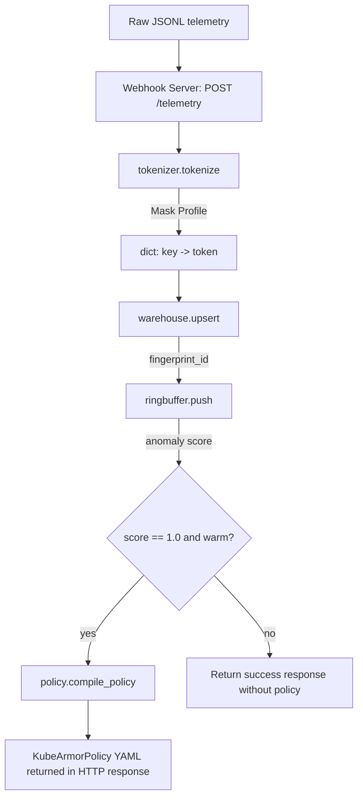

# Project Fingerling — Architecture

Maintained by Morpheus. Covers the POC scope (STORY-FING-01..04) and Sprint 2 (STORY-FING-05..08).

## 1. System Overview

The system consists of five independent, composable pure-Python library modules and a webhook ingestion server:

| Module | Story | Responsibility |
|---|---|---|
| `fingerling/tokenizer.py` | STORY-FING-01, -07 | JSONPath extraction (fixed, wildcard `[*]`, and recursive descent `..`) + modifier engine |
| `fingerling/warehouse.py` | STORY-FING-02, -05 | MD5 folding, stateful upsert, and baseline whitelist compiler |
| `fingerling/ringbuffer.py` | STORY-FING-03 | FIFO sliding-window N-gram anomaly matcher |
| `fingerling/policy.py` | STORY-FING-04, -06 | KubeArmorPolicy YAML manifest compiler with tuple-aligned API |
| `fingerling/server.py` | STORY-FING-08 | stdlib HTTP webhook telemetry ingestion server |

## 2. Architectural Principles

- **No new third-party dependencies.** JSONPath resolution is hand-rolled (supporting dot, bracket index, wildcard `[*]`, and recursive descent `..`). Python's stdlib `http.server` is used for webhook ingestion. `PyYAML` remains the only non-stdlib dependency.
- **Stable contracts over inferred behavior.** Ambiguities are resolved with explicit parameters.
- **Deterministic and Stable Tokens.** Multiple matches from a wildcard `[*]` or recursive descent `..` path are evaluated individually, sorted alphabetically, deduplicated, and joined with commas to form a stable aggregate token.

## 3. Component Diagram



## 4. Class & Data Structures

### 4.1 `tokenizer.py` (STORY-FING-01, STORY-FING-07)

```python
@dataclass(frozen=True)
class MaskEntry:
    key: str
    path: str
    modifier: str

def resolve_path(record: dict, path: str) -> Any | _MISSING: ...
def apply_modifier(value, modifier: str) -> str: ...
def tokenize(record: dict, mask_profile: list[MaskEntry]) -> dict[str, str]: ...
def parse_jsonl(jsonl_text: str) -> list[dict]: ...
```

**Wildcard and Recursive Descent Semantics (STORY-FING-07):**
- Paths with `[*]` map a modifier over every element of an array, producing a sorted, deduplicated, comma-joined list of tokens (e.g. `"TRUE,TRUE"` becomes `"TRUE"`, `"6379,443"` becomes `"443,6379"`).
- Paths with `..` recursively traverse down the dictionary and list hierarchies.
- Empty/missing matches default to `"FALSE"` or `"NULL"`, never raising exceptions.

### 4.2 `warehouse.py` (STORY-FING-02, STORY-FING-05)

```python
def fingerprint_id(tokens: dict[str, str]) -> str: ...

@dataclass
class FingerprintRecord:
    total_occurrences: int
    first_seen: str
    last_seen: str
    min_duration_ms: float
    max_duration_ms: float
    samples: list[dict]

class Warehouse:
    def upsert(self, tokens: dict[str, str], duration_ms: float, raw_record: dict, timestamp: str | None = None) -> str: ...
    def load(self, path: str) -> None: ...
    def save(self, path: str) -> None: ...

def build_whitelist(records: list[dict], mask_profile: list[MaskEntry], n: int) -> set[tuple[str, ...]]:
    """Observe baseline telemetry, tokenize and upsert each record, and return whitelisted N-gram tuples."""
```

### 4.3 `ringbuffer.py` (STORY-FING-03)

```python
class SlidingWindowMatcher:
    def __init__(self, n: int, whitelist: set[tuple[str, ...]]): ...
    @property
    def warm(self) -> bool: ...
    def push(self, fingerprint_id: str) -> float: ...
```

### 4.4 `policy.py` (STORY-FING-04, STORY-FING-06)

```python
def compile_policy(
    workload_name: str,
    match_labels: dict[str, str],
    anomalous_trajectory: str | tuple[str, ...],
    namespace: str = "default",
    action: Literal["Block", "Post"] = "Block",
) -> str:
    """Compile KubeArmorPolicy CRD. anomalous_trajectory accepts tuples directly."""
```

### 4.5 `server.py` (STORY-FING-08)

```python
class TelemetryHTTPRequestHandler(BaseHTTPRequestHandler):
    """Handles POST /telemetry requests in-process."""
```
- Ingests JSONL payload batches.
- Invokes the pipeline sequentially.
- Responds with processing statistics and compiled policies.

## 5. Technical Stack

- **Language:** Python 3.13
- **Stdlib:** `hashlib`, `dataclasses`, `collections.deque`, `re`, `http.server`, `json`
- **Third-party:** `PyYAML`
- **Test runner:** `unittest`

## 6. Decisions Log (Sprint 2 additions)

7. **Wildcard & Recursive Descent Path Resolution**: Hand-rolled recursive crawler in `tokenizer.py` to support `[*]` and `..` without adding external JSONPath library overhead.
8. **Token Aggregation Semantics**: Multiple resolved values are tokenized individually, sorted alphabetically, deduplicated, and joined with commas to maintain stable and deterministic tokens.
9. **Aligned Policy API**: The `compile_policy` function now accepts `tuple[str, ...]` directly, resolving the string-joining overhead and aligning it with the output structure of `SlidingWindowMatcher`.
10. **stdlib HTTP Ingestion**: Standard library `http.server` handles `POST /telemetry` to remain fully offline and lightweight.
