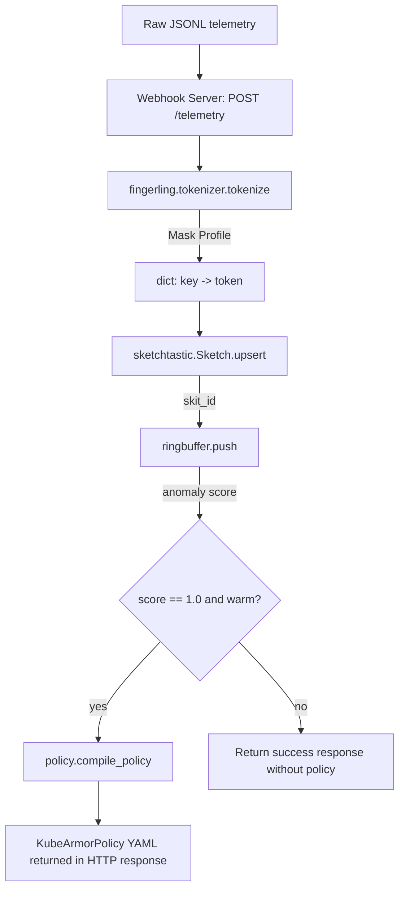

# Project Fingerling — Architecture

Maintained by Morpheus. Module map current as of Sprint 9 (2026-10-13); sections 3-4 detail the
fingerprinting core. Per-sprint design rationale lives in `docs/sprints/USER_STORIES_SPRINT<N>.md`; how
the project is built, changed and released is in `docs/SDLC.md`.

## 1. System Overview

The repository holds one Python package, `fingerling`. The fingerprint tool it builds on is
**sketch-tastic** (`sketchtastic`), developed in its own repository,
[drusifer/sketch-tastic](https://github.com/drusifer/sketch-tastic), and installed here as a git
dependency (Sprint 18). Its architecture and decisions are documented there; this document
covers only how `fingerling` uses it.

**`fingerling`** (`fingerling/`, repository root) — the detection-and-response pipeline built on
fingerprint IDs. **Parked** and unpublished: kept importable and tested, not developed.

| Module | Story | Responsibility |
|---|---|---|
| `fingerling/tokenizer.py` | FING-39 | eBPF-side `tokenize(record, fields)` and `parse_jsonl` |
| `fingerling/warehouse.py` | FING-05, -28 | Owns `TELEMETRY_AGGREGATES` and the N-gram `build_whitelist` helper |
| `fingerling/ringbuffer.py` | FING-03 | FIFO sliding-window N-gram anomaly matcher |
| `fingerling/policy.py` | FING-04, -06, -22 | KubeArmorPolicy YAML compiler (`block_pattern` adds `matchPattern`) |
| `fingerling/server.py` | FING-08 | stdlib HTTP webhook telemetry ingestion server |
| `fingerling/gitops.py` | Sprint 3 | Commit/merge compiled policies into a GitOps repo (optional GPG signing) |
| `fingerling/sandbox.py`, `vaccine.py` | Sprint 4 | Controlled-exposure sandbox and baseline/exploit replay |
| `fingerling/capture.py` | — | bpftrace `execve` capture → Tetragon-shaped JSONL |

N-gram analysis is deliberately a later stage: it sees only the fingerprint IDs
`sketchtastic.Sketch.upsert()` returns (skit ids).

## 2. Architectural Principles

- **Few third-party dependencies.** `PyYAML` and, since Sprint 8, `python-jsonpath` (pure Python, no transitive deps) for full JSONPath syntax. The hand-rolled resolver from the POC is gone. Python's stdlib `http.server` is used for webhook ingestion. Dependencies are declared in `pyproject.toml` and install into a project `.venv` via `make install`.
- **Stable contracts over inferred behavior.** Ambiguities are resolved with explicit parameters.
- **Deterministic and Stable Tokens.** Token shape depends only on how many values a path selects: none → "missing", one → that value, several → each tokenized, deduplicated, sorted and comma-joined.
- **One fold path.** Aggregator state is plain data that is loaded and folded further; a set built over many runs equals one built in a single pass by construction.

## 3. Component Diagram



## 4. Class & Data Structures

### 4.1 sketch-tastic (external)

`Field`, `tokens`, `Aggregate`, `Sketch` and `skit_id` come from `sketchtastic`; see the
sketch-tastic README and `docs/` for their design. (Sections 4.1 and 4.2 described them while
they lived here, up to Sprint 17.)

### 4.3 `ringbuffer.py` (STORY-FING-03)

```python
class SlidingWindowMatcher:
    def __init__(self, n: int, whitelist: set[tuple[str, ...]]): ...
    @property
    def warm(self) -> bool: ...
    def push(self, fingerprint_id: str) -> float: ...
```

### 4.4 `policy.py` (STORY-FING-04, STORY-FING-06)

```python
def compile_policy(
    workload_name: str,
    match_labels: dict[str, str],
    anomalous_trajectory: str | tuple[str, ...],
    namespace: str = "default",
    action: Literal["Block", "Post"] = "Block",
    block_pattern: str | None = None,
) -> str:
    """Compile KubeArmorPolicy CRD. anomalous_trajectory accepts tuples directly."""
```

### 4.5 `server.py` (STORY-FING-08)

```python
class TelemetryHTTPRequestHandler(BaseHTTPRequestHandler):
    """Handles POST /telemetry requests in-process."""
```
- Ingests JSONL payload batches.
- Invokes the pipeline sequentially.
- Responds with processing statistics and compiled policies.

## 5. Technical Stack

- **Language:** Python 3.14 and later (3.14 and 3.15 tested)
- **Stdlib:** `hashlib`, `dataclasses`, `collections.deque`, `http.server`, `json`, `argparse`
- **Third-party:** `PyYAML`, `python-jsonpath`; `rich` for the parked demo only
- **Tooling:** `uv` (workspace + lockfile), `hatchling`, `ruff`, `gitleaks`, GitHub Actions — see `docs/SDLC.md`
- **Test runner:** `unittest`

## 6. Decisions Log (Sprint 2 additions)

7. **Wildcard & Recursive Descent Path Resolution**: Hand-rolled recursive crawler in `tokenizer.py` to support `[*]` and `..` without adding external JSONPath library overhead.
8. **Token Aggregation Semantics**: Multiple resolved values are tokenized individually, sorted alphabetically, deduplicated, and joined with commas to maintain stable and deterministic tokens.
9. **Aligned Policy API**: The `compile_policy` function now accepts `tuple[str, ...]` directly, resolving the string-joining overhead and aligning it with the output structure of `SlidingWindowMatcher`.
10. **stdlib HTTP Ingestion**: Standard library `http.server` handles `POST /telemetry` to remain fully offline and lightweight.

## 7. Decisions Log (Sprint 8 additions)

11. **Library JSONPath** (supersedes #7): `python-jsonpath` replaces the hand-rolled resolver; full syntax was needed for complex events.
12. **Project venv**: the system Python is externally managed (PEP 668), so dependencies are declared in `pyproject.toml` and installed into an isolated `.venv`, and the Makefile selects it automatically.
13. **Declared aggregators replace hardcoded stats**: `upsert(duration_ms, raw_record)` became `upsert(tokens, record)`; duration bounds and sample ring are now `TELEMETRY_AGGREGATES`.
14. **Profile-bound sets**: a set records the `profile_id` of its `fields`; merging under another profile is refused unless forced.
15. **Sampling tool is independent of sequence analysis**: n-grams/scoring stay a downstream stage.

## 8. Decisions Log (Sprint 9 additions)

16. *(Superseded in Sprint 18: the tool moved to drusifer/sketch-tastic.)* **Two packages, one repository**: the fingerprint tool is `fingerprint-sampler`, a uv workspace member published on its own; `fingerling` is private and depends on it.
17. **Move behind shims**: parked modules import the old `fingerling.*` paths, which re-export the same objects, so the split changed no parked code.
18. **`fingerprint merge`**: a subcommand, so later commands (`check`, `show`) sit beside it. (The `fingerling fingerprint` alias was removed in Sprint 12.)
19. *(Superseded in Sprint 18.)* **One version stream**: only `fingerprint-sampler` is versioned, tagged (`v<version>`) and published.
