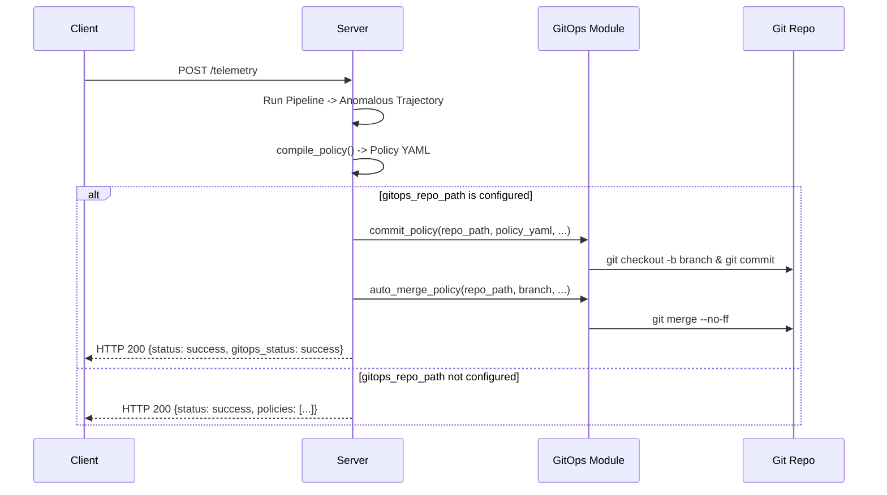

# Sprint 3: "Automated GitOps Delivery Pipeline"

This document combines **User Stories** and **Architecture Design** for Sprint 3.

*   **Total Points**: 12 Story Points
*   **Backlog Source**: `docs/SOURCE_SPEC.md` FR-GIO-01 (Automated Workload-Bound GitOps Delivery)

---

## 📋 User Stories & Acceptance Criteria

### STORY-FING-09: Local Git Repository Scaffolding
**Points:** 2 · **Epic:** Automated GitOps Delivery
**Role:** DevSecOps Engineer

**As a** DevSecOps Engineer,
**I want** a library function to initialize and scaffold a local Git repository workspace,
**so that** I can dynamically stage and verify GitOps delivery pipelines.

#### Acceptance Criteria
1. Function `fingerling.gitops.initialize_repo(repo_path: str, default_branch: str = "main") -> None` creates a directory (if it doesn't exist) and runs `git init -b <default_branch>`.
2. Automatically configures local repo username (`git config user.name "Fingerling Bot"`) and email (`git config user.email "bot@fingerling.io"`) if not already globally set, preventing commit failures.
3. Creates a placeholder file (e.g. `README.md`) and makes an initial commit to establish the default branch head.

---

### STORY-FING-10: GPG-Signed Branch and Commit Generator
**Points:** 4 · **Epic:** Automated GitOps Delivery
**Role:** DevSecOps Automation Specialist

**As a** DevSecOps Automation Specialist,
**I want** a module to check out a hotfix branch and commit a policy manifest with GPG signing,
**so that** all policies written to the GitOps track have cryptographically verified origins.

#### Acceptance Criteria
1. Function `fingerling.gitops.commit_policy(repo_path: str, policy_yaml: str, workload_name: str, branch_name: str, gpg_sign: bool = False, gpg_key_id: str | None = None) -> None`:
   - Checks out a new branch named `branch_name`.
   - Writes `policy_yaml` to `policies/fingerling-<workload_name>.yaml`.
   - Configures the local GPG key id (`git config user.signingkey <gpg_key_id>`) if `gpg_key_id` is provided.
   - Commits the file. If `gpg_sign` is True, runs `git commit -S -m ...`. If signing fails due to missing keys/tools, it raises a `RuntimeError` describing the GPG error.
2. The folder structure `policies/` is automatically created inside the repo if it does not exist.

---

### STORY-FING-11: Auto-Merge Delivery Pipeline
**Points:** 3 · **Epic:** Automated GitOps Delivery
**Role:** DevSecOps Automation Specialist

**As a** DevSecOps Automation Specialist,
**I want** to programmatically merge the hotfix branch back into the main branch,
**so that** the manifest is auto-merged to trigger cluster reconciliation.

#### Acceptance Criteria
1. Function `fingerling.gitops.auto_merge_policy(repo_path: str, branch_name: str, target_branch: str = "main") -> None`:
   - Checks out `target_branch`.
   - Merges `branch_name` back using `git merge --no-ff -m ...`.
   - Cleans up by deleting the local hotfix branch `branch_name`.
2. Handles merge conflicts by raising a `RuntimeError`.

---

### STORY-FING-12: Webhook GitOps Integration
**Points:** 3 · **Epic:** Live Ingestion
**Role:** DevSecOps Engineer

**As a** DevSecOps Engineer,
**I want** the Webhook Ingestion Server to automatically commit and merge compiled policies to a local GitOps repo,
**so that** threat detection directly triggers automated deployment delivery.

#### Acceptance Criteria
1. Server handler factory `create_handler` and `run_server` in `fingerling/server.py` accept optional GitOps configuration parameters: `gitops_repo_path: str | None = None`, `gpg_sign: bool = False`, `gpg_key_id: str | None = None`.
2. When an anomaly is detected and a policy is compiled:
   - If `gitops_repo_path` is configured, automatically runs the GitOps pipeline (checkout branch -> commit -> merge target branch).
   - Injects the GitOps pipeline status (`"gitops_status": "success"` or `"gitops_status": "failed: <reason>"`) into the JSON HTTP response.

---

## 🛠️ Architecture & Technical Design

### Class & Data Structures

We introduce [fingerling/gitops.py](file:///home/drusifer/Projects/fingerling/fingerling/gitops.py):

```python
import subprocess
import os

def _run_git(args: list[str], cwd: str) -> str:
    """Helper to run git commands safely via subprocess."""
    res = subprocess.run(["git"] + args, cwd=cwd, capture_output=True, text=True)
    if res.returncode != 0:
        raise RuntimeError(f"Git command failed: git {' '.join(args)}\nStderr: {res.stderr}")
    return res.stdout
```

### In-Process Ingestion Integration Flow


