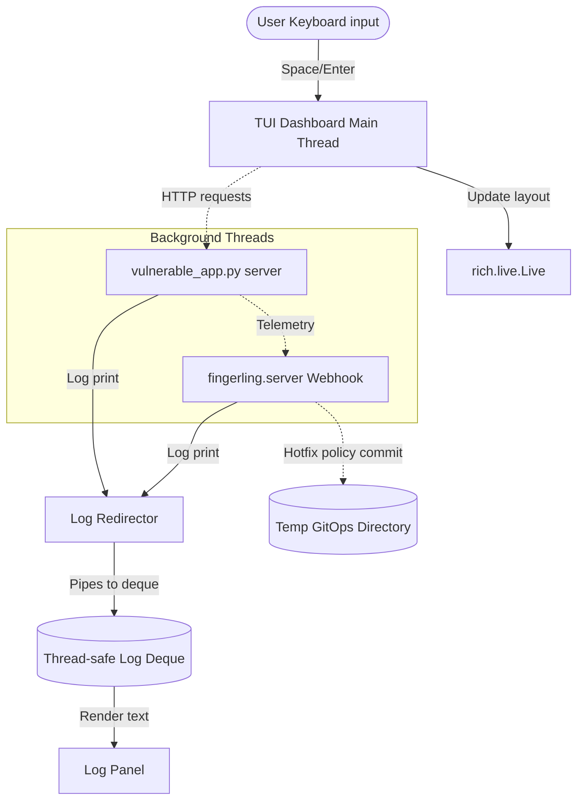

# Sprint 6 User Stories: Rich TUI UX Demo Epic

## STORY-FING-20: Rich TUI Dashboard Layout and Widgets
**As a** user running the Project Fingerling vaccination demo,
**I want** a unified, visually rich Text User Interface (TUI) instead of separate tmux panes,
**So that** I can view the vulnerable code, live eBPF telemetry, call-stack fingerprints, app logs, and explanations in a single terminal window.

### Acceptance Criteria
1. **Unified TUI Screen**: Uses Python `rich` (specifically `rich.layout.Layout` and `rich.live.Live`) to split the screen into:
   - **Header**: Demo title and project status.
   - **Vulnerable Code Viewer**: Highlights the vulnerable shell execution line in the Target App.
   - **eBPF Telemetry Tracker**: Displays baseline traces, compiled whitelists, and highlights the anomalous `sys_execve` call stack transitions.
   - **Scrolling Server Logs**: Displays real-time stdout/stderr from the background Target App and Webhook server.
   - **Narrative Pane**: Displays detailed explanatory text with color-coded emojis guiding the user through the 8 steps.
   - **Footer**: Keybindings (`Space`/`Enter` to step, `Q` to quit).
2. **Visual States & Transitions**:
   - Stage 1-2 (Baseline): Highlights the clean call transitions (`sys_connect -> sys_read`).
   - Stage 3 (Attack): Highlights the anomalous transition in red (`sys_read -> sys_execve`).
   - Stage 4 (Antibody): Displays the compiled policy structure alongside the blocked fingerprint.
   - Stage 5 (Hot-patch check): Shows a status alert indicating the policy is active and the target server PID remains unchanged (no restart required).

---

## STORY-FING-21: Unified TUI Live Run Engine and Pipes
**As a** system developer running the demo,
**I want** the TUI to spawn the Webhook and App servers in background threads, capture their stdout, and update all panel states in real-time,
**So that** the demo requires zero external dependencies, zero tmux sessions, and can run successfully on any terminal.

### Acceptance Criteria
1. **Background Processes**: Spawns the vulnerable application and telemetry webhook servers in daemon background threads.
2. **Log Redirection**: Intercepts `sys.stdout` and `sys.stderr` from background servers and pipes them into a thread-safe deque displayed in the scrolling log pane.
3. **Step-Through Gateways**: Advances the demo state on user input, executing GET requests, writing policies, and querying the server dynamically.
4. **Cleanup Guarantee**: On TUI exit (normal completion or abort via `Q` or `Ctrl+C`), stops background servers and deletes the temporary GitOps repository directory on the host.
5. **Makefile Automation**: Introduces `make demo-rich` to run the TUI launcher script directly.

---

## Technical Architecture Design (Morpheus)

### Component Breakdown
1. **TUI Layout (`examples/tui_demo.py`)**:
   - Organized via `rich.layout.Layout`.
   - Header pane: Visual banner.
   - Upper Left pane: Code viewer. Pulls vulnerable snippet from `examples/vulnerable_app.py`, syntax-highlighted using `rich.syntax.Syntax`, highlighting the OS command injection flaw (specifically the `os.system` invocation).
   - Lower Left pane: Step narrative. Displays rich markdown instructions and next-step actions.
   - Upper Right pane: Syscall telemetry status. Displays transition traces:
     - Baseline warm-up: normal 2-grams listed in a table.
     - Anomalous trigger: highlights `sys_execve` in red text.
     - Antibody state: displays the generated KubeArmorPolicy yaml side-by-side with the active block.
   - Lower Right pane: Live server log stream. Pulls text from the `Log Redirector` buffer.
   - Footer pane: Keyboard shortcuts.
2. **Log Redirector (`examples/tui_demo.py:LogPipe`)**:
   - Custom `io.StringIO` subclass replacing `sys.stdout` and `sys.stderr` inside the target threads to forward server prints to a shared thread-safe queue.
3. **Exploit Replayer (`examples/tui_demo.py:TUIDriver`)**:
   - Handles demo state transitions (1 to 8). On each transition:
     - Triggers active HTTP GET requests.
     - Triggers command injection exploit payloads.
     - Monitors the webhook server's database matching and policy compilations.
     - Performs GitOps commit merges.
     - Checks enforcement against subsequent exploit attempts.
4. **Cleanup Protocol**:
   - Registers signal handlers for `SIGINT`, `SIGTERM`, and `SIGHUP`.
   - On shutdown, terminates the background HTTP servers (`server.shutdown()`) and deletes the temporary GitOps repository directory on the host.

